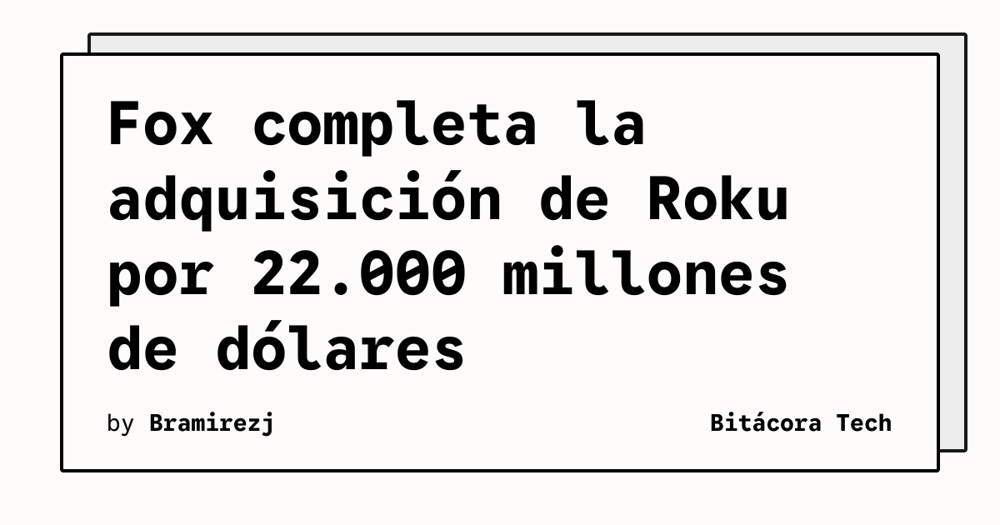

Fox completó la adquisición de Roku por 22.000 millones de dólares, según informó TechCrunch. La operación incorpora a la compañía de streaming al grupo de Fox después de que investigadores del Departamento de Justicia examinaran el acuerdo durante los meses previos.

## Qué implica

Roku aporta a Fox una plataforma tecnológica de distribución y una relación directa con una amplia base de hogares estadounidenses. El acuerdo combina el negocio de contenidos y deportes de Fox con el sistema operativo, los dispositivos y el alcance publicitario de Roku.

La operación también cambia la posición de Fox en el mercado de televisión conectada. La empresa ya no dependerá únicamente de sus canales y servicios propios para llegar a los espectadores: podrá utilizar una plataforma que organiza aplicaciones, publicidad y reproducción de contenidos en televisores y dispositivos compatibles.

## Hechos confirmados

- Fox anunció el cierre de la adquisición de Roku por 22.000 millones de dólares.
- El Departamento de Justicia había examinado la operación antes de su finalización.
- Roku llega a más de 100 millones de hogares en Estados Unidos, según la información citada por TechCrunch.
- Fox indicó que la combinación podría ampliar su audiencia estadounidense mediante la tecnología de Roku, su plataforma, Roku Channel y el contenido de Fox.
- Fox también opera Fox One, además de sus negocios de deportes, noticias y estaciones locales.

## Análisis

El valor estratégico de la compra no está solo en sumar un catálogo o una marca conocida. Fox obtiene una capa de distribución y datos de uso que puede conectar sus contenidos con la experiencia de acceso del público. Para Roku, quedar dentro de un grupo de medios cambia sus incentivos comerciales y puede acelerar la integración entre plataforma, publicidad y programación propia. El resultado dependerá de cómo se mantenga la neutralidad de la plataforma frente a otros servicios.

**Fuente:** [TechCrunch](https://techcrunch.com/2026/11/06/fox-completes-its-22b-acquisition-of-roku/).
