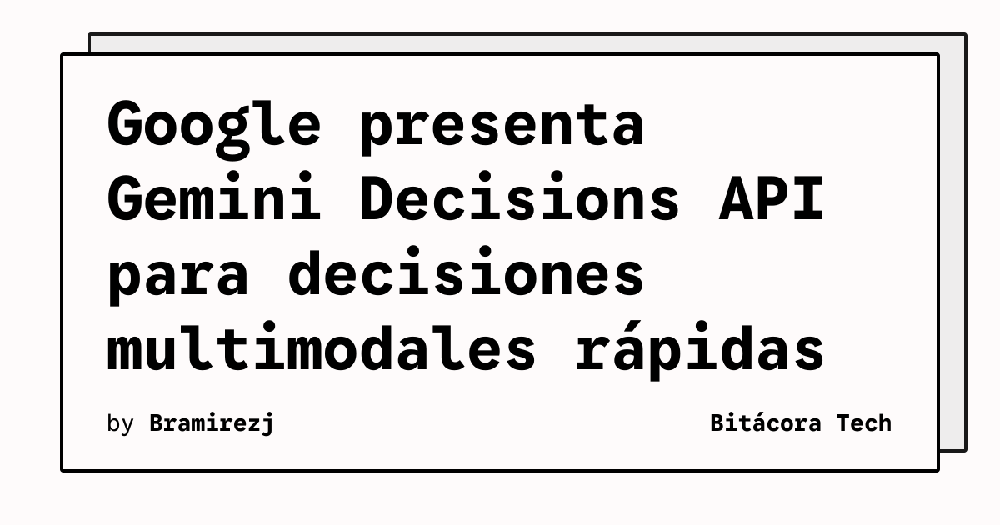

Google presentó Gemini Decisions API, un endpoint orientado a decisiones cerradas y acotadas que funciona con el modelo Gemini Decision 1. La propuesta busca resolver elecciones como seleccionar una herramienta, comprobar una política, enrutar una consulta o puntuar contexto sin generar una respuesta extensa token a token.

## Qué implica

La API acepta una entrada multimodal de hasta 256.000 tokens y permite plantear hasta 1.000 preguntas independientes de tipo sí/no, selección o puntuación mediante rúbrica. El sistema devuelve probabilidades y puntuaciones de confianza para las opciones candidatas en una sola pasada del modelo.

Google indica una latencia de extremo a extremo de entre 150 y 250 milisegundos. También fija un precio de 0,10 dólares por cada millón de tokens de entrada y señala que no factura tokens de salida para este endpoint. El acceso se ofrece mediante Gemini API en Google AI Studio, con guías para Python, JavaScript y REST.

## Hechos confirmados

- Gemini Decision 1 procesa texto, imágenes, audio, vídeo y documentos PDF en una misma entrada.
- Una petición puede incluir hasta 1.000 preguntas independientes y un contexto de hasta 256.000 tokens.
- La API devuelve probabilidades y confianza para decisiones cerradas, en lugar de limitarse a generar texto.
- Google afirma que el modelo muestra un rendimiento destacado en pruebas de enrutamiento de agentes, razonamiento, clasificación y comprensión multimodal.

## Análisis

El diseño reduce una tarea frecuente en sistemas con modelos: convertir una respuesta abierta en una clasificación utilizable por software. Si las latencias y la calibración anunciadas se mantienen en escenarios reales, el endpoint podría simplificar puertas de control, evaluaciones y selección de herramientas en flujos de agentes. Aun así, las puntuaciones de confianza no sustituyen la validación de los casos límite ni una política de revisión humana cuando una decisión tenga consecuencias relevantes.

**Fuente:** [Google](https://blog.google/innovation-and-ai/technology/developers-tools/gemini-decisions-api/).
