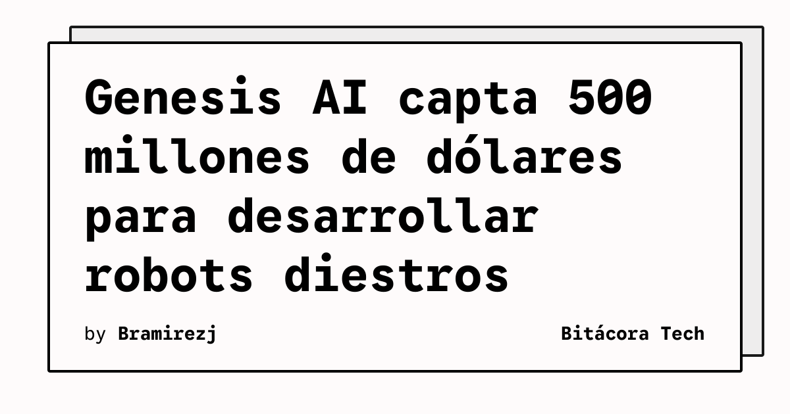

Genesis AI captó 500 millones de dólares en una ronda Serie A para desarrollar robots capaces de manipular objetos con mayor destreza. La empresa mostró brazos robóticos que recogían cajas, las escaneaban, las colocaban en otra caja, la cerraban y aplicaban una etiqueta. La demostración también dejó ver un límite importante: el sistema falló al repetir una tarea pequeña.

## Qué implica

La compañía combina datos propios, un modelo generativo y el diseño de un robot humanoide. Más de 100 trabajadores utilizan guantes con sensores y cámaras en auriculares para aportar datos de fuerza y movimiento. Genesis usa esa información para entrenar el modelo y simular experiencias antes de llevarlas al hardware.

La empresa afirma haber construido entre 30 y 40 unidades de su robot Eno y estar haciendo pruebas con algunos clientes no identificados. También indicó que eligió un fabricante por contrato para iniciar el próximo año la producción en Estados Unidos. El artículo señala que las manos robóticas actuales solo pueden trabajar unas semanas antes de necesitar reemplazo.

## Hechos confirmados

- La Serie A de 500 millones de dólares está liderada por Khosla Ventures, Premji Invest y Eclipse.
- Genesis fue fundada en 2024 por Zhou Xian y Théophile Gervet.
- La empresa utiliza guantes con sensores y cámaras para reunir datos de trabajadores reales.

El enfoque de la startup intenta cerrar el ciclo entre datos, simulación y hardware. La demostración es relevante porque combina varios pasos de manipulación en una sola secuencia, aunque el fallo durante la repetición recuerda que la robustez en entornos reales todavía requiere más pruebas.
- Genesis ha construido entre 30 y 40 robots Eno y prueba el sistema con un grupo reducido de clientes.

## Análisis

La ronda refleja el interés inversor por la IA física, pero la demostración muestra que la fiabilidad sigue siendo el desafío central. En robótica, una excepción pequeña puede detener una línea completa. La ventaja de Genesis dependerá menos de una demostración aislada que de convertir los datos de uso en ciclos de mejora, reducir el desgaste de las manos y mantener un coste operativo compatible con el trabajo que pretende automatizar.

**Fuente:** [TechCrunch](https://techcrunch.com/2026/11/17/genesis-ai-raises-500-million-to-deploy-electric-glove-wearing-robots/).
