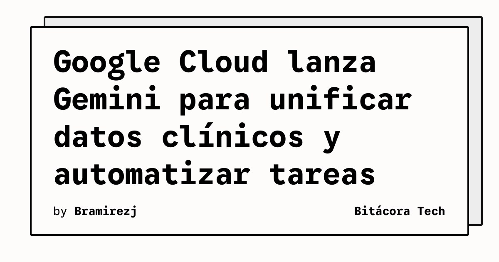

Google Cloud presentó Gemini para salud, una propuesta orientada a unificar datos clínicos y automatizar flujos de trabajo. La página oficial de Google describe el lanzamiento como una forma de reducir la carga administrativa que soportan los profesionales sanitarios. El feed de Tech Daily Brief lo registró el 10 de noviembre de 2026 con importancia crítica.

La noticia se sitúa en una zona especialmente sensible de la adopción de inteligencia artificial: los sistemas sanitarios reúnen información clínica, procesos administrativos y decisiones que afectan a pacientes. Por eso, la promesa de automatización no equivale por sí sola a una implantación segura o eficaz. El anuncio confirma la dirección del producto, pero no permite concluir que todas las tareas clínicas queden automatizadas.

## Qué implica

Unificar datos puede reducir el tiempo que los equipos dedican a buscar información repartida entre sistemas. Automatizar flujos también podría aliviar tareas repetitivas y liberar capacidad para la atención. En ambos casos, el resultado dependerá de la calidad de las integraciones, de los controles de acceso y de la revisión humana de las salidas.

La fuente oficial presenta Gemini para salud como una oferta de Google Cloud, no como una sustitución general del criterio profesional. La descripción disponible tampoco aporta métricas de precisión, disponibilidad por país ni una lista completa de sistemas compatibles. Esos datos serán necesarios para evaluar el producto más allá del anuncio.

## Hechos confirmados

- Google Cloud lanzó Gemini para salud.
- Google presenta la propuesta como una manera de unificar datos clínicos.
- La compañía afirma que puede automatizar flujos de trabajo y reducir la carga administrativa.

## Análisis

El valor técnico estará en la conexión entre la IA y los sistemas que ya utilizan los centros, no solo en el modelo. En un entorno sanitario, una integración útil debe hacer trazables sus resultados, limitar el acceso a la información adecuada y mantener una revisión responsable. Mientras no se publiquen más detalles, conviene leer el lanzamiento como una propuesta de infraestructura y automatización, no como evidencia de impacto clínico.

**Fuente:** [Google AI](https://blog.google/innovation-and-ai/infrastructure-and-cloud/google-cloud/gemini-for-healthcare/).
