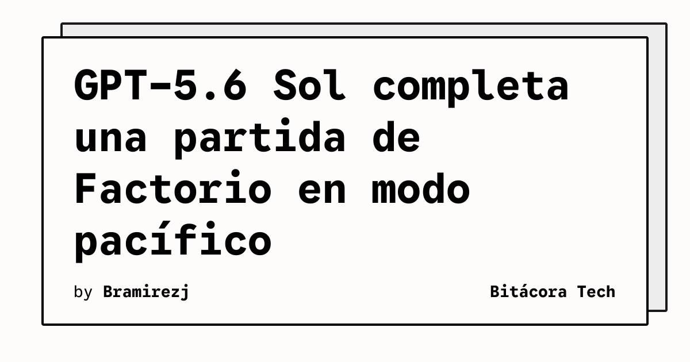

Una prueba publicada por Ryan Madden examina el desempeño de GPT-5.6 Sol en Factorio, un juego de automatización y producción. El experimento se realizó en el modo pacífico y plantea una pregunta concreta: hasta dónde puede llegar un modelo cuando debe mantener una cadena de objetivos dentro de un entorno interactivo.

## Qué implica

Factorio exige dividir metas, reunir recursos y coordinar decisiones a lo largo del tiempo. Un resultado favorable en este contexto no demuestra inteligencia general, pero sí ofrece una forma reproducible de observar planificación, memoria operativa y recuperación ante errores dentro de un mundo con reglas explícitas.

El artículo enlazado desde Hacker News presenta el experimento y su resultado. La historia disponible en el feed no detalla por sí sola la configuración completa, los controles usados ni el criterio exacto para considerar terminada la partida, por lo que esos aspectos deben interpretarse con cautela.

## Hechos confirmados

- La prueba utiliza GPT-5.6 Sol como agente en Factorio.
- El escenario elegido es el modo pacífico del juego.
- El artículo de Ryan Madden afirma que el modelo puede superar ese desafío.

## Análisis

Los entornos de videojuegos pueden servir como laboratorios baratos para estudiar agentes que deben planificar y actuar de forma sostenida. La comparación será útil solo si se publican las mismas condiciones, los intentos fallidos y la intervención humana. Más que una medida única de capacidad, una partida de Factorio funciona como una prueba acotada de coordinación entre objetivos y acciones.

**Fuente:** [Ryan Madden](https://ryanmadden.net/gpt-56-beats-factorio/).
