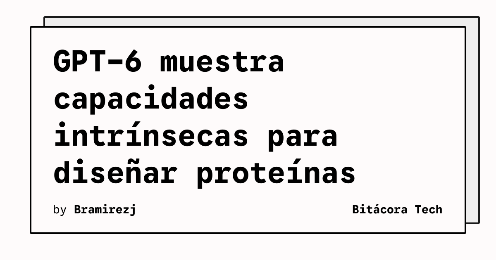

OpenAI presentó resultados de GPT-6 en una tarea que conecta los modelos de lenguaje con el diseño computacional de proteínas. La publicación describe capacidades para trabajar con estructuras y secuencias proteicas usando razonamiento y código, en lugar de limitarse a resumir información científica existente.

El anuncio es relevante porque sitúa al modelo en un flujo experimental concreto: proponer diseños que después pueden evaluarse en el laboratorio. La propia publicación subraya que los resultados son pruebas de capacidad y no una validación de un tratamiento, una proteína terapéutica o un producto listo para uso clínico.

## Qué implica

El diseño de proteínas exige coordinar representaciones distintas. Una secuencia determina el orden de aminoácidos; una estructura describe cómo esa cadena se organiza; y una prueba de unión permite comprobar si el diseño interactúa con un objetivo. Un modelo capaz de pasar entre esas representaciones puede reducir parte del trabajo iterativo de los investigadores, aunque todavía depende de experimentos y controles externos.

La diferencia importante frente a una demostración puramente conversacional es que GPT-6 combina razonamiento y código. Esa combinación permite expresar un diseño, transformarlo y someterlo a evaluaciones reproducibles. El resultado no elimina la necesidad de herramientas especializadas, pero puede servir como interfaz para explorar hipótesis con mayor rapidez.

## Hechos confirmados

- OpenAI afirma que GPT-6 diseña estructuras y secuencias de proteínas mediante razonamiento y código.
- Las pruebas de laboratorio descritas encontraron evidencias de unión en cinco objetivos.
- La publicación presenta los resultados como una demostración de capacidades de diseño intrínsecas del modelo.

## Análisis

La señal más importante es metodológica: el valor del modelo se mide por su capacidad de producir candidatos evaluables, no solo por la calidad de una explicación. Aun así, una evidencia de unión no equivale por sí misma a eficacia, seguridad ni utilidad clínica. El siguiente paso razonable es comparar estos diseños con métodos especializados y publicar protocolos que permitan reproducir los resultados.

**Fuente:** [OpenAI](https://openai.com/index/gpt-6-models-demonstrate-intrinsic-protein-design-capabilities/).
