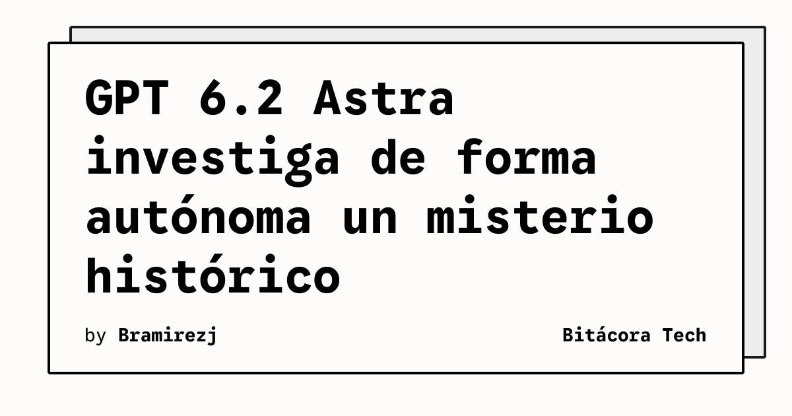

Un ensayo publicado en Generative History describe una prueba de GPT 6.2 Astra aplicada a una pregunta histórica abierta. Según el autor, el modelo identificó al creador de un cuaderno de bocetos anónimo de 1808 conservado en la biblioteca Beinecke de Yale tras consultar fuentes primarias y secundarias.

El texto presenta el caso como una prueba de investigación de extremo a extremo: el sistema debía leer material disponible, proponer una hipótesis con evidencia limitada y buscar una fuente que permitiera comprobarla. El autor afirma que el proceso tomó 22 minutos y que el modelo encontró un documento poco conocido en un archivo que respaldaba la hipótesis inicial.

## Qué implica

La tarea es distinta de responder una pregunta factual con información ya resumida. El modelo tuvo que combinar pistas dispersas, decidir qué fuente adicional podía ser útil y usar esa fuente para contrastar una atribución. El resultado descrito por el autor no convierte automáticamente la hipótesis en consenso histórico, pero sí ilustra una forma de asistencia para investigaciones con fuentes heterogéneas.

El artículo también menciona una prueba con una transcripción de 8.002 filas del cuaderno contable Shipboy & Henry. El autor afirma que GPT 6.2 revisó la transcripción contra 353 imágenes y usó las relaciones matemáticas del libro para detectar y corregir errores en cantidades, precios, subtotales y totales.

Estas tareas exigen más que generación de texto. La calidad depende de que el agente encuentre documentos pertinentes, mantenga el contexto durante una investigación prolongada y deje una cadena de evidencias que otra persona pueda revisar. El propio artículo advierte que el modelo puede expresarse de manera extraña y producir respuestas que requieren comprobación cuidadosa.

## Hechos confirmados

- El artículo de Generative History está firmado por Mark Humphries, profesor de Historia en Wilfrid Laurier University.
- La prueba descrita se centró en un cuaderno de bocetos anónimo de 1808 conservado en la biblioteca Beinecke de Yale.
- El autor afirma que GPT 6.2 Astra identificó a su creador en 22 minutos usando fuentes públicas.
- El ensayo también describe una revisión de una transcripción de 8.002 filas frente a 353 imágenes.

## Análisis

El caso sugiere que los modelos pueden ser útiles como asistentes para formular hipótesis y localizar evidencia, especialmente cuando una investigación combina lectura, comparación y cálculos. Su valor práctico estará en la trazabilidad: cada atribución debe conservar las fuentes consultadas y permitir que un especialista repita la comprobación.

La rapidez no sustituye la validación humana. Una fuente encontrada por un modelo puede estar mal interpretada, ser incompleta o no sostener por sí sola una conclusión. El escenario más sólido es usar Astra para ampliar la búsqueda y reservar la afirmación final para una revisión documental independiente.

**Fuente:** [Generative History](https://generativehistory.substack.com/p/gpt-62-astra-solves-a-historical), verificada y abierta.
