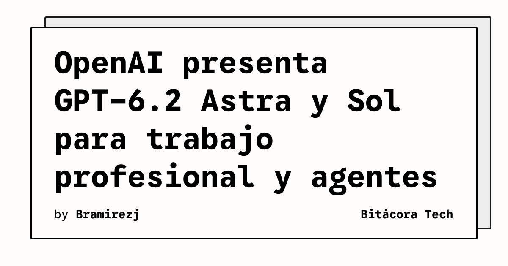

OpenAI presentó GPT-6.2 Astra y GPT-6.2 Sol como dos modelos con objetivos distintos. Astra apunta a proyectos profesionales complejos, mientras Sol se orienta al trabajo cotidiano con un coste menor. El anuncio oficial sitúa las mejoras en una combinación de calidad, uso de herramientas y eficiencia, no solo en respuestas más largas.

## Qué implica

Para los equipos de ingeniería, la novedad más relevante está en los flujos que encadenan varias acciones. OpenAI afirma que Astra escribe código más limpio, construye interfaces web con mejor funcionamiento y usa el ordenador con mayor precisión. Sol conserva un perfil más rápido y económico para tareas repetitivas o de volumen.

La diferencia entre ambos modelos puede influir en la arquitectura de una aplicación. Un sistema podría reservar Astra para planificar cambios complejos, revisar entregables o trabajar con herramientas visuales, y emplear Sol para clasificación, borradores y operaciones frecuentes. Esa separación debe comprobarse con datos propios: los resultados publicados por el proveedor son referencias, no garantías para cada proyecto.

El anuncio también conecta los modelos con ChatGPT Work, Codex y la API. Eso amplía el impacto potencial desde el chat hacia herramientas que ya forman parte de los procesos de desarrollo. Aun así, la integración no elimina la necesidad de permisos limitados, registros de auditoría y revisión humana en operaciones que modifiquen sistemas o datos.

## Hechos confirmados

- OpenAI anunció GPT-6.2 Astra y GPT-6.2 Sol el 17 de noviembre de 2026.
- La empresa describe mejoras en documentos, hojas de cálculo, presentaciones, código, uso del ordenador y diseño web.
- Según OpenAI, el precio de entrada y salida de tokens de Astra en la API es un 20 % menor que el de GPT-6 Astra, con un descuento del 60 % para entradas en caché.
- OpenAI afirma que ambos modelos alcanzan el umbral «Critical» de capacidades de ciberseguridad de su marco de preparación y que se lanzan con protecciones más estrictas para asistencia de alto riesgo.

## Análisis

El anuncio refuerza una tendencia hacia modelos especializados por nivel de complejidad y coste. Para adoptar Astra o Sol con criterio, conviene medir latencia, consumo de tokens, tasa de revisión humana y calidad de las llamadas a herramientas en tareas reales. La mejora declarada solo será operativa si esos indicadores compensan el cambio de modelo y las nuevas restricciones de seguridad.

**Fuente:** [OpenAI](https://openai.com/index/introducing-gpt-6-2-astra-sol/).
