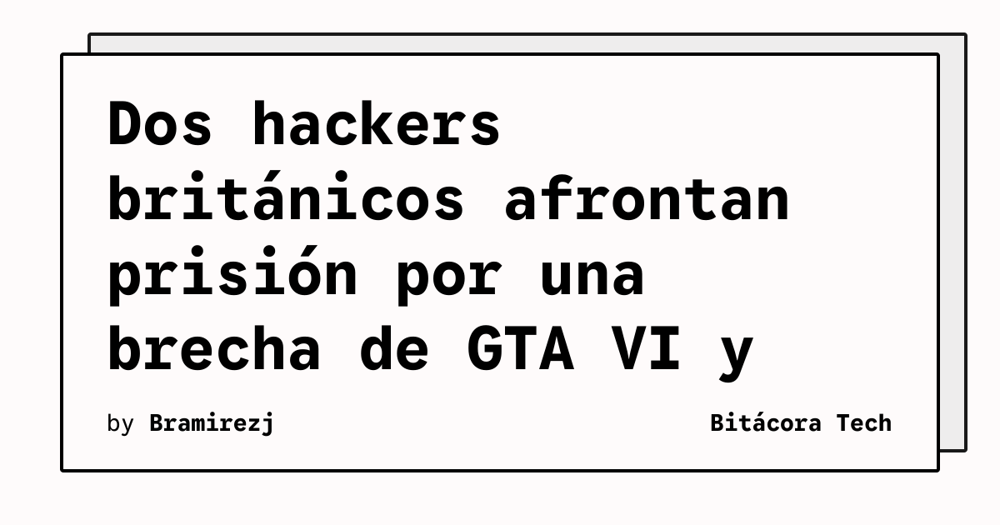

La cobertura de TechCrunch describe dos procesos contra hackers británicos vinculados con campañas de intrusión que afectaron a empresas y, en otro caso, a Rockstar Games, desarrolladora de Grand Theft Auto VI. El caso combina robo de activos digitales, acceso no autorizado y filtración de material previo al lanzamiento.

## Qué implica

El caso ilustra que las operaciones contra compañías tecnológicas no dependen únicamente de vulnerabilidades sofisticadas. La información publicada apunta también al uso de suplantación de equipos de soporte para conseguir credenciales y abrir el camino hacia sistemas internos.

Para los equipos de seguridad, la lección operativa es concreta: las defensas deben cubrir tanto los controles técnicos como los procesos de atención al empleado. La autenticación resistente al phishing, la verificación de solicitudes urgentes y la supervisión de accesos privilegiados reducen el margen de maniobra de este tipo de campañas.

## Hechos confirmados

- TechCrunch informa que dos hackers británicos afrontan condenas por ataques separados.
- Tyler Buchanan, de Dundee, fue sentenciado en Estados Unidos a seis años de prisión y, según el artículo, fue acusado de robar al menos 11 millones de dólares en criptomonedas.
- Arion Kurtaj, de Oxford, se declaró culpable de varios ciberataques, incluido el robo de datos y la extorsión de Rockstar Games.
- La fuente relaciona los hechos con grupos de ciberdelincuencia y con técnicas de suplantación de mesas de ayuda para obtener credenciales.

## Análisis

La noticia vuelve a situar la ingeniería social en el centro del riesgo empresarial. El valor de una cuenta comprometida puede superar al de una vulnerabilidad aislada cuando permite moverse por servicios financieros, repositorios o sistemas de producción. La respuesta más sólida combina controles de identidad, límites de privilegio y entrenamiento verificable, no solo alertas posteriores al incidente.

También resulta relevante la diferencia entre los dos expedientes. El primero se relaciona con el acceso a cuentas y el robo de activos digitales; el segundo, con la extracción de información y la extorsión de una empresa de videojuegos. No son exactamente el mismo tipo de intrusión, aunque ambos muestran cómo una cuenta o un sistema comprometido puede convertirse en una plataforma para obtener beneficios y presionar a la víctima.

La dimensión judicial añade un dato de contexto: la investigación de un ataque puede continuar durante años y cruzar jurisdicciones. Para las compañías, conservar registros fiables de accesos, llamadas y transferencias no es solo una tarea de cumplimiento; también puede ser decisivo para reconstruir la cadena de hechos y colaborar con las autoridades.

**Fuente:** [TechCrunch](https://techcrunch.com/2026/11/18/british-hackers-face-prison-for-gta-6-data-breach-and-crypto-thefts/).
