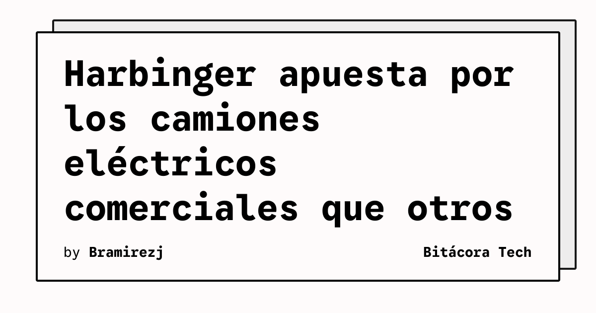

Harbinger está construyendo una estrategia distinta dentro del mercado de vehículos eléctricos: competir en los camiones medianos de reparto y carga, no en los modelos de consumo que concentran la atención pública. Según The Verge, la startup recaudó 240 millones de dólares en una ronda Serie D y también consiguió un pedido de 300 millones de dólares de FedEx, además de un nuevo contrato de defensa con el ejército estadounidense.

La empresa trabaja con furgones y camiones de caja de las clases 4 a 6, un segmento que el artículo describe como esencial para la actividad económica, pero menos atractivo para los grandes fabricantes. Harbinger fue fundada en 2021 por profesionales con experiencia en Canoo, QuantumScape y Faraday Future. Su director ejecutivo, John Harris, sostiene que este espacio intermedio entre los vehículos ligeros y los camiones pesados sigue poco atendido.

## Qué implica

El enfoque desplaza la discusión desde la popularidad de los turismos eléctricos hacia la electrificación de flotas que recorren rutas repetitivas y cumplen funciones logísticas. En estos vehículos, la disponibilidad, el coste operativo y la integración con la infraestructura de una empresa pueden importar tanto como el diseño o la autonomía anunciada para el consumidor.

The Verge señala que las plataformas de vehículos eléctricos de pasajeros no tienen necesariamente la durabilidad necesaria para crecer hacia camiones medianos. En el otro extremo, las plataformas de servicio pesado pueden resultar demasiado grandes y costosas para reducirlas. Esa separación técnica deja un espacio concreto para un fabricante especializado.

## Hechos confirmados

- Harbinger anunció una ronda Serie D de 240 millones de dólares.
- La startup recibió un pedido de 300 millones de dólares de FedEx y obtuvo un contrato de defensa con el ejército estadounidense.
- Su objetivo son las furgonetas de reparto y los camiones de caja de las clases 4 a 6.
- La empresa ensambla internamente sus paquetes de baterías y unidades de tracción, y planea añadir inversores a esa integración.

## Análisis

La apuesta de Harbinger sugiere que la especialización puede ser una vía más realista que perseguir desde el inicio el mercado masivo. Si los pedidos anunciados se convierten en producción sostenida, la startup podría demostrar que la electrificación comercial también necesita plataformas diseñadas para sus propias restricciones. Esa conclusión es una lectura editorial, no una garantía de ejecución industrial.

**Fuente:** [The Verge](https://www.theverge.com/transportation/1038448/harbinger-ev-startup-240m-series-d-fedex-army-trucks).
