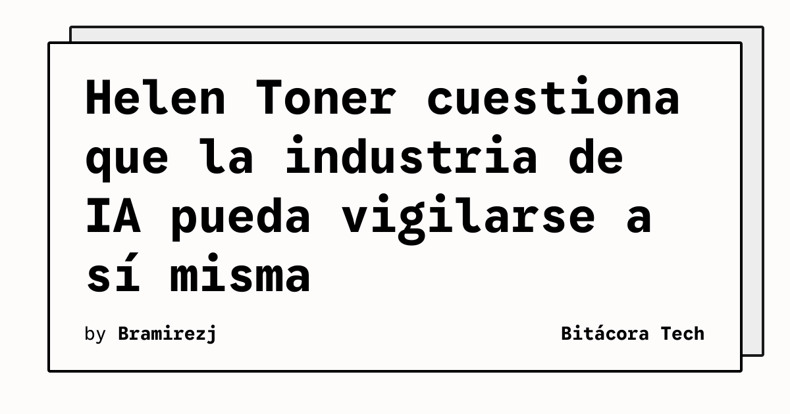

Helen Toner, investigadora de seguridad y política de IA y exintegrante del consejo de OpenAI, sostiene que no basta con confiar en que los directivos de las empresas actuarán siempre de forma responsable. La conversación publicada por The Verge parte de su experiencia durante la crisis que terminó con el regreso de Sam Altman como director ejecutivo y la salida posterior de Toner del consejo.

## Qué implica

El episodio permite examinar una pregunta de gobernanza: qué ocurre cuando el órgano creado para vigilar la misión de seguridad de una organización intenta ejercer esa responsabilidad y la estructura de rendición de cuentas se rompe. The Verge recuerda que el consejo sin ánimo de lucro de OpenAI debía proteger su misión frente a una prioridad excesiva por el crecimiento y el beneficio.

La entrevista amplía el debate hacia la regulación, la alineación y las presiones comerciales que afrontan los laboratorios de frontera. Toner también comenta que una política de seguridad no debería depender de que una única persona sea digna de confianza. La conversación se publicó como parte de una serie sobre IA en la vida real.

El valor de la conversación está en conectar una disputa corporativa concreta con una cuestión más amplia de diseño institucional. No presenta una solución técnica cerrada ni sustituye la revisión de los modelos, pero sí plantea qué mecanismos externos pueden exigir explicaciones cuando los incentivos de una empresa cambian rápidamente.

## Hechos confirmados

- Helen Toner fue una de las integrantes del consejo de OpenAI que votó para retirar a Sam Altman.
- Altman regresó como director ejecutivo y Toner dejó posteriormente el consejo.
- Toner dirige el Center for Security and Emerging Technology de Georgetown University.
- La entrevista aborda seguridad de IA, alineación, regulación y presiones comerciales.

## Análisis

La experiencia descrita apunta a que la gobernanza no puede descansar únicamente en compromisos internos o en la reputación de un directivo. Los consejos necesitan autoridad clara, información suficiente y procedimientos que sobrevivan a los conflictos entre seguridad y crecimiento. Eso no resuelve por sí solo los problemas técnicos de la IA, pero sí define quién puede intervenir cuando una organización considera que sus controles han fallado.

**Fuente:** [The Verge](https://www.theverge.com/podcast/1032907/helen-toner-openai-cset-ai-safety-policy-interview).
