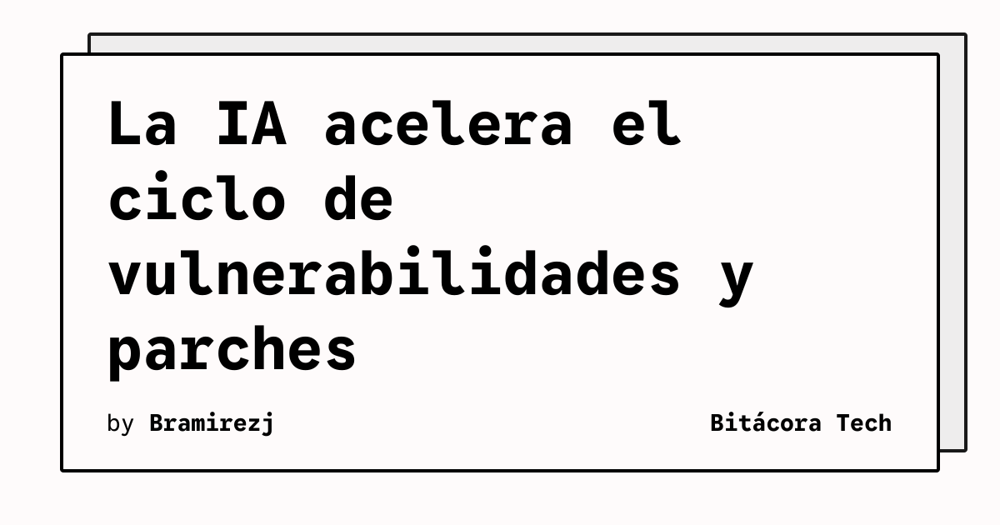

La inteligencia artificial está comprimiendo el tiempo que separa el descubrimiento de una vulnerabilidad de su posible explotación. WIRED describe un ciclo en el que las herramientas de IA ayudan a encontrar fallos, los atacantes pueden intentar aprovecharlos con mayor rapidez y los equipos de tecnologías de la información deben evaluar y desplegar más parches en menos tiempo.

El artículo aclara que los incidentes recientes no fueron causados por una campaña coordinada de ataques con IA. Microsoft atribuyó una interrupción de 365 a una actualización defectuosa agravada por otros fallos de red. También se citan problemas de parcheo en comunicaciones internas de la NSA y un fallo relacionado con una actualización interna de Apple. El vínculo que propone la publicación es sistémico: la velocidad del cambio aumenta la presión sobre infraestructuras que ya arrastran deuda técnica.

## Qué implica

Para operaciones y seguridad, el problema central es el tiempo de validación. Un parche urgente debe comprobarse, desplegarse y observarse sin perder de vista que dejar el sistema sin actualizar puede ser más arriesgado. La automatización puede ayudar a ordenar avisos y preparar cambios, pero no sustituye la revisión humana del origen del fallo, el alcance de la corrección ni los efectos sobre servicios dependientes.

WIRED recoge que el total de vulnerabilidades registradas en 2026 superó las 100.000. La cifra incluye fallos que no tienen el mismo impacto. El artículo también señala que el catálogo de vulnerabilidades explotadas de CISA incorporó 300 durante el año, mientras que VulnCheck calculó 1.500 vulnerabilidades conocidas como explotadas. Esas cantidades son menores que el total descubierto, pero la publicación destaca que el ritmo de uso malicioso ha aumentado.

## Hechos confirmados

- Investigadores y atacantes están usando IA en distintas fases del ciclo de vulnerabilidades, según WIRED.
- El total de vulnerabilidades registradas en 2026 superó las 100.000, de acuerdo con las cifras citadas en el artículo.
- WIRED relaciona interrupciones recientes con actualizaciones defectuosas, fallos de red y problemas de parcheo, no con una campaña coordinada de IA.
- Las herramientas de IA pueden acelerar la evaluación, pero los especialistas citados mantienen la necesidad de análisis humano.
- CISA registró 300 vulnerabilidades explotadas en su catálogo durante el año; VulnCheck estimó 1.500 conocidas como explotadas.

## Análisis

La lección operativa no es culpar a la IA cada vez que un servicio falla. Es asumir que el ciclo de mantenimiento se volvió más exigente. Las organizaciones necesitan inventarios fiables, pruebas automatizadas, despliegues graduales y capacidad para revertir cambios. Sin esas bases, acelerar la búsqueda de fallos puede aumentar la cola de decisiones pendientes en lugar de mejorar la seguridad.

**Fuente:** [WIRED](https://www.wired.com/story/brace-yourself-for-years-of-outage-chaos/).
