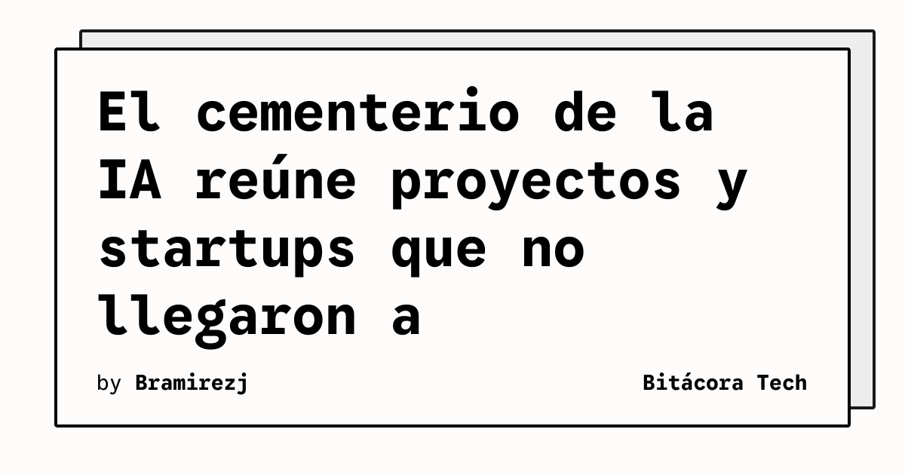

La historia de la inteligencia artificial también se escribe con productos que se retrasan, se cierran o no alcanzan la escala esperada. TechCrunch publicó una lista de proyectos y startups que no llegaron a consolidarse, con ejemplos que incluyen la Siri de IA de Apple y el lanzamiento del «super app» de OpenAI.

## Qué implica

El artículo funciona como un registro en evolución, no como una clasificación definitiva de toda la industria. Su punto de partida es que los anuncios de IA suelen presentarse como señales de crecimiento, mientras que los cierres y los cambios de rumbo quedan dispersos entre comunicados, retrasos y decisiones de producto. Reunir esos casos permite observar la distancia entre una promesa pública y un resultado que finalmente llega al mercado.

La fuente identifica dos patrones concretos en su descripción: el retraso repetido de la IA de Siri y un lanzamiento de OpenAI descrito como desordenado. La nota no convierte esos ejemplos en una prueba de que la tecnología haya fracasado en general. Cada caso puede responder a problemas diferentes de producto, ejecución, costes o expectativas, y requiere revisar su contexto individual.

Para lectores técnicos, la recopilación es especialmente útil como recordatorio de que una demostración o un anuncio no equivale a un servicio mantenido. La continuidad exige usuarios, operaciones sostenibles y una propuesta que sobreviva a la siguiente iteración del mercado. Sin esos elementos, incluso una capacidad llamativa puede terminar fuera de la hoja de ruta.

## Hechos confirmados

- TechCrunch mantiene una lista de proyectos y startups de IA que cerraron o no cumplieron sus expectativas.
- La descripción del artículo menciona los retrasos repetidos de la Siri de IA de Apple.
- La misma descripción menciona el lanzamiento del «super app» de OpenAI.
- La publicación está fechada el 14 de noviembre de 2026.

## Análisis

Los proyectos cancelados son una señal útil para equilibrar el relato de crecimiento permanente que domina el sector. La lista puede ayudar a detectar costes de oportunidad y decisiones que no produjeron un producto sostenible, pero no basta para medir el rendimiento técnico de cada iniciativa. La lectura más sólida consiste en separar el cierre de un proyecto de la viabilidad de la capacidad que intentaba desarrollar.

**Fuente:** [TechCrunch](https://techcrunch.com/2026/11/14/the-ai-graveyard-a-running-list-of-projects-and-startups-that-didnt-make-it/).
