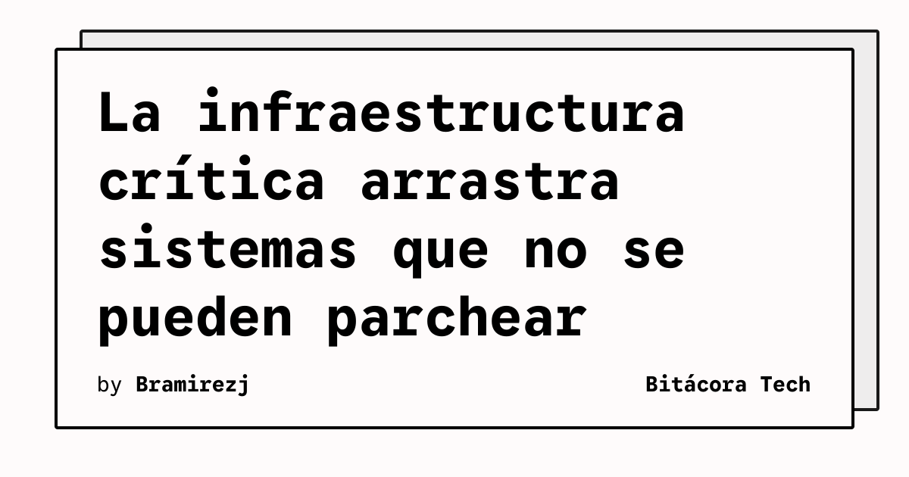

La expansión de la inteligencia artificial aumenta la capacidad de automatizar tareas, pero también pone presión sobre sistemas que fueron construidos sin una ruta clara de actualización. TechCrunch recoge una advertencia de Satya Nadella: una parte de la infraestructura crítica y de los sistemas que gobiernan hardware y transporte tiene vulnerabilidades que no son fáciles de corregir.

## Qué implica

El problema no se limita a instalar un parche. En entornos conectados, una actualización puede estar bloqueada por hardware antiguo, dependencias propietarias, requisitos de disponibilidad o ausencia de un mecanismo seguro de reemplazo. Cuando el componente permanece expuesto, la organización debe compensar el riesgo con segmentación, control de acceso, supervisión y planes de continuidad.

La conversación sobre ataques asistidos por IA vuelve más urgente esa deuda técnica. Una herramienta automatizada podría acelerar el descubrimiento de fallos, pero la existencia de un sistema difícil de actualizar convierte la remediación en un desafío de arquitectura y gobernanza.

## Hechos confirmados

- TechCrunch informó que Nadella habló sobre el problema durante el DealBook Summit de The New York Times.
- La fuente describe sistemas de software estadounidenses, incluidos los vinculados con hardware y transporte, con vulnerabilidades difíciles o imposibles de corregir.
- El artículo relaciona la advertencia con nuevas oportunidades y desafíos de seguridad asociados a la IA.
- La noticia también menciona que Nadella minimizó la reciente caída de Outlook en ese contexto.

## Análisis

La seguridad de un sistema no puede medirse solo por la velocidad con la que publica parches. Para infraestructura crítica, la capacidad de actualizar, aislar o retirar un componente debería formar parte del diseño inicial y de las compras tecnológicas. Cuando ya no es posible cambiarlo, la transparencia sobre esa limitación permite priorizar controles compensatorios y evitar que una dependencia invisible se convierta en un punto único de fallo.

La dificultad aumenta cuando la infraestructura combina proveedores, dispositivos físicos y software con ciclos de vida distintos. Una organización puede actualizar su aplicación y, aun así, mantener expuesto un componente situado más abajo en la cadena. Por eso el inventario de activos debe incluir versiones, dependencias, responsables y condiciones de reemplazo, no solo nombres de productos.

La advertencia también afecta a las decisiones de compra. Antes de incorporar una plataforma conectada, conviene preguntar cómo se distribuyen actualizaciones, qué ocurre cuando termina el soporte y si existe una forma independiente de limitar el acceso. Esas respuestas permiten estimar el riesgo operativo antes de que una limitación técnica quede instalada durante años.

**Fuente:** [TechCrunch](https://techcrunch.com/2026/11/18/amidst-fears-of-ai-cyberattacks-satya-nadella-says-lots-of-critical-infrastructure-is-unpatchable/).
