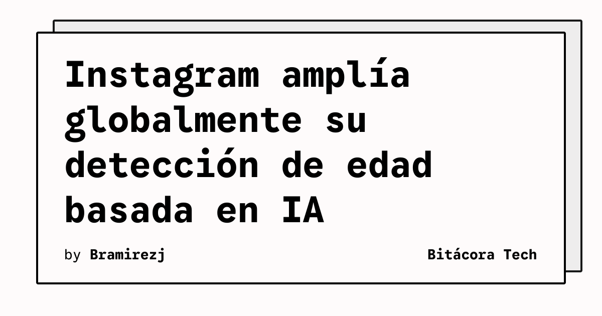

Instagram está ampliando a escala global la tecnología que estima la edad de sus usuarios para identificar a adolescentes que no han declarado correctamente su fecha de nacimiento. La medida busca incorporar a millones de personas más a las protecciones de las cuentas para adolescentes, según la información publicada por Meta y recogida por *The Verge*.

La noticia sitúa la estimación de edad como una capa adicional a los datos que el usuario proporciona al abrir su cuenta. El sistema intenta detectar señales que podrían indicar que una persona es menor de 18 años, incluso cuando su perfil muestra una edad distinta.

## Qué implica

La expansión aumenta el alcance de una decisión automatizada que puede cambiar la experiencia de uso de Instagram. Cuando el sistema considera probable que una cuenta pertenezca a un adolescente, la plataforma puede aplicar las restricciones y configuraciones asociadas a las cuentas para adolescentes.

La información disponible describe un análisis de señales de comportamiento y contexto. Entre ellas aparecen los perfiles y tipos de contenido con los que interactúa una persona, los mensajes de cumpleaños que recibe y los temas generales o indicios visuales presentes en las fotografías que sube.

Este enfoque también plantea un reto técnico y de producto: estimar una característica sensible a partir de señales indirectas sin convertir una predicción en una identidad confirmada. El resultado puede afectar a adultos clasificados de forma incorrecta o a adolescentes que no sean detectados.

## Hechos confirmados

- Meta está extendiendo globalmente su tecnología de estimación de edad en Instagram.
- La compañía afirma que el despliegue colocará a millones de adolescentes más bajo las protecciones de las cuentas para adolescentes.
- El sistema busca señales como interacciones, mensajes de cumpleaños y temas o indicios visuales de las fotografías.
- Las actualizaciones de aseguramiento de edad ya se habían lanzado en Estados Unidos, la Unión Europea y Brasil.

## Análisis

La expansión muestra que la moderación de la edad se está desplazando desde la declaración explícita del usuario hacia sistemas de inferencia. Eso puede reducir algunos casos de exposición inadecuada, pero también hace más importante que la plataforma explique sus límites y ofrezca mecanismos claros para corregir errores. La eficacia real dependerá de cómo se equilibren protección, privacidad y revisión de las decisiones automatizadas.

**Fuente:** [The Verge](https://www.theverge.com/tech/1029627/meta-instagram-ai-age-assurance-global-expansion).
