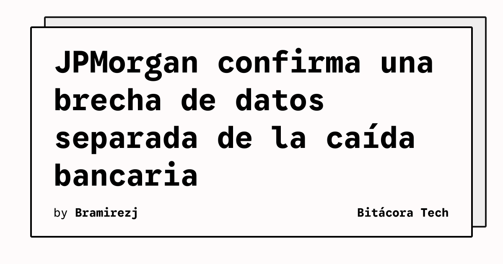

JPMorgan Chase confirmó que varios proveedores externos fueron objetivo de un ciberataque. La intrusión expuso datos de marketing, incluidos nombres y direcciones de correo electrónico, según la información publicada por The Verge. La entidad sostiene que el incidente no está relacionado con la interrupción bancaria registrada durante la misma semana.

## Qué implica

La separación entre ambos hechos es relevante. Una caída de servicio puede tener una causa operativa, mientras que una brecha en un proveedor puede comprometer datos sin afectar necesariamente la disponibilidad de los sistemas principales. Tratar ambos sucesos como un único incidente llevaría a una lectura equivocada del alcance y de las medidas de respuesta.

Para los equipos técnicos, el caso vuelve a poner el foco en la superficie de terceros. Los proveedores que participan en marketing, analítica o comunicaciones pueden manejar información personal aunque no formen parte del núcleo transaccional del banco. Por eso, el inventario de accesos y la revisión de contratos deben cubrir también esos servicios periféricos.

## Hechos confirmados

- JPMorgan dijo que proveedores externos fueron objetivo de un ciberataque.
- La información expuesta incluye nombres y direcciones de correo electrónico de clientes.
- The Verge informó que un reporte de Cybernews vinculó la filtración con alrededor de 16.000 direcciones de correo.
- JPMorgan afirmó que el ataque no tiene conexión con la caída bancaria de esta semana, atribuida a un error de software.

## Análisis

El principal aprendizaje es de trazabilidad: una organización necesita poder distinguir rápidamente entre indisponibilidad, acceso no autorizado y exposición de datos. Esa clasificación permite comunicar con precisión, priorizar la contención y evitar que una crisis operativa oculte una alerta de privacidad. También sugiere que las revisiones de seguridad de terceros deben medir no solo la posibilidad de entrar a un sistema, sino qué datos puede consultar cada proveedor.

**Fuente:** [The Verge](https://www.theverge.com/tech/1037695/jpmorgan-chase-cyberattack).
