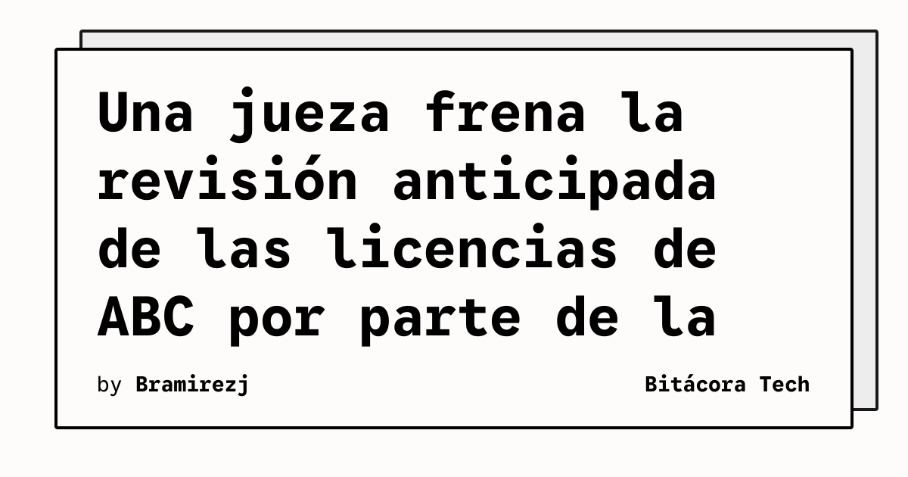

La jueza federal estadounidense Loren AliKhan bloqueó la revisión anticipada de las licencias de emisión de ABC por parte de la Comisión Federal de Comunicaciones (FCC), según The Verge. La decisión aparece como una medida cautelar y mantiene abierta la disputa entre la cadena y el regulador.

ABC había acusado a la FCC de vulnerar sus derechos de libertad de expresión y de emprender una campaña de represalias por contenidos emitidos. La jueza rechazó además el intento de la agencia de desestimar la demanda de ABC. En su resolución señaló que la cadena probablemente tendría éxito en su reclamación de represalias, de acuerdo con el artículo de The Verge.

## Qué implica

El conflicto une dos planos: el calendario regulatorio de las licencias de emisión y los límites constitucionales de la actuación de una agencia frente a una empresa de medios. La orden no decide definitivamente el fondo del litigio, pero impide que la revisión anticipada avance mientras continúa el proceso judicial.

The Verge explica que las licencias de emisión de ABC, cuya empresa matriz es Disney, no estaban previstas para renovarse hasta 2028. La diferencia entre ese calendario y la revisión que intentaba adelantar la FCC es central para entender por qué la medida cautelar tiene efecto práctico inmediato.

## Hechos confirmados

- La jueza federal Loren AliKhan dictó una medida cautelar contra la revisión anticipada de las licencias de ABC.
- La FCC es la agencia estadounidense que había intentado realizar esa revisión.
- ABC acusa a la agencia de una campaña de represalias relacionada con contenidos emitidos.
- La jueza rechazó la petición de la FCC para desestimar la demanda.
- La renovación ordinaria de las licencias no estaba prevista hasta 2028, según The Verge.

## Análisis

La resolución refuerza la importancia de separar una medida provisional de una sentencia sobre el fondo. Para empresas reguladas, el caso también evidencia que una disputa sobre contenidos puede trasladarse rápidamente al calendario de licencias y a la estrategia legal. El alcance final dependerá de las siguientes decisiones del tribunal.

**Fuente:** [The Verge](https://www.theverge.com/policy/1043116/fcc-disney-abc-broadcast-licenses-review-early-judge-block).
