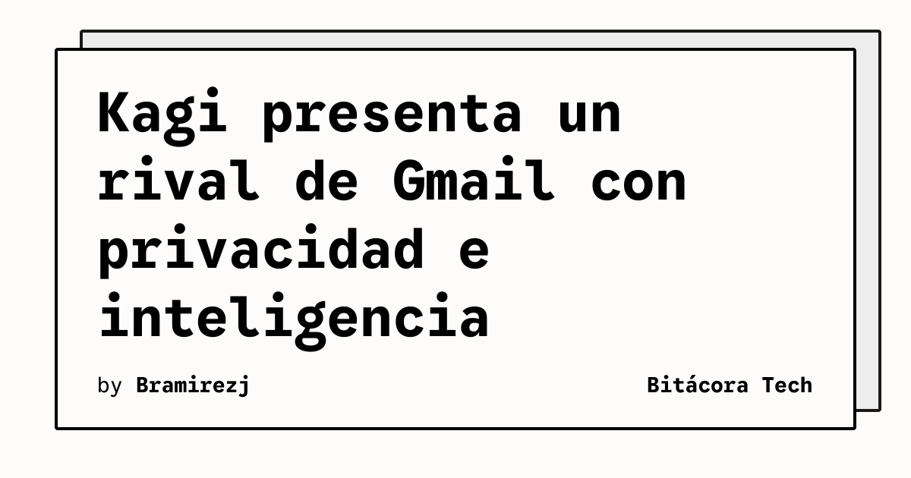

Kagi, conocido por su buscador de pago, presentó un servicio de correo electrónico que compite con Gmail. Ars Technica describe la propuesta como una combinación poco habitual de promesas de privacidad y funciones de inteligencia artificial, dos argumentos que suelen aparecer por separado en los productos de correo.

La entrada de Kagi extiende la estrategia de la compañía más allá de las búsquedas. El correo puede convertirse en la prueba más exigente para esa promesa de control. Un correo electrónico ofrece un espacio con datos personales, conversaciones y documentos, por lo que sus decisiones sobre tratamiento de información tienen un peso distinto al de una página de resultados. La propuesta intenta diferenciarse de los servicios financiados principalmente por publicidad. Esa diferencia solo será sostenible si el usuario entiende qué recibe a cambio de pagar, especialmente durante la migración.

## Qué implica

Para los usuarios, la privacidad de un correo no depende solo de una declaración comercial. También importa qué datos se almacenan, cuánto tiempo permanecen disponibles, qué procesos automatizados los analizan y qué controles tiene la persona para revisar o eliminar información.

Las funciones de IA añaden una segunda capa de evaluación. Pueden ayudar a ordenar mensajes o resumir conversaciones, pero el servicio debe explicar qué contenido se procesa y bajo qué condiciones. En un producto de correo, la confianza se construye tanto con la utilidad como con límites claros sobre el uso de los mensajes.

## Hechos confirmados

- Kagi lanzó un servicio de correo que se presenta como alternativa a Gmail.
- La propuesta combina promesas de privacidad con funciones de inteligencia artificial.
- El lanzamiento amplía la oferta de Kagi, que ya opera un buscador de pago.

## Análisis

Kagi no necesita igualar el tamaño de Gmail para resultar relevante. Puede atraer a personas dispuestas a pagar por reducir la publicidad y obtener controles más explícitos sobre sus datos. El desafío será convertir esa diferenciación en una experiencia completa: migración sencilla, compatibilidad con el correo existente y funciones de IA que aporten valor sin volver opaco el tratamiento de información sensible.

**Fuente:** [Ars Technica](https://arstechnica.com/gadgets/2026/11/google-search-alternative-kagi-launches-gmail-rival/).
