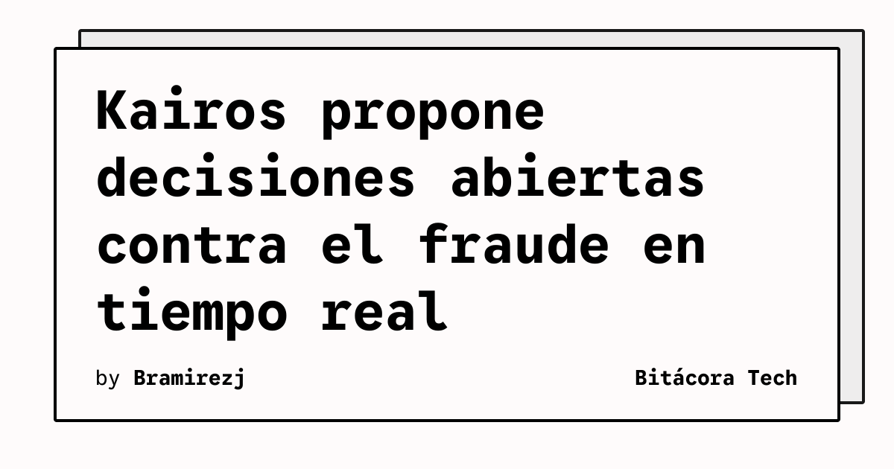

Finic presenta Kairos como una plataforma de código abierto para tomar decisiones de riesgo y fraude en tiempo real. El repositorio oficial describe un sistema que evalúa registros, inicios de sesión, pedidos, pagos y retiros, y conserva cada decisión junto con las señales que la sustentan.

## Qué implica

Kairos combina modelos de decisión con aprendizaje automático tradicional. Su modelo Grayson responde preguntas expresadas en lenguaje natural y puede trabajar con pocos datos etiquetados y señales no estructuradas. Después, esas respuestas pueden utilizarse junto con datos numéricos en regresiones logísticas o árboles potenciados compatibles con XGBoost.

La plataforma también está orientada a agentes de desarrollo. El repositorio documenta un servidor MCP para conectar Claude Code, Cursor, Codex o VS Code, así como SDK para TypeScript y Python, una CLI, una API HTTP y despliegue autónomo con Docker. También incluye documentación para integrar webhooks y revisar casos por personas.

## Hechos confirmados

- Una decisión puede devolver `approve`, `step up`, `review` o `block`, junto con una puntuación de riesgo y sus razones.
- Los flujos pueden pedir una decisión, puntuar con un modelo, bifurcarse, llamar webhooks y abrir casos para revisión humana.
- Kairos publica soporte para experimentos que comparan variantes de modelos con datos históricos.
- El repositorio se distribuye bajo la licencia Apache-2.0.
- La instalación local documentada requiere Node.js 22, pnpm 10 y una clave de API de Grayson.

El proyecto distingue entre el modelo de decisión, que puede leer datos no estructurados y trabajar antes de disponer de miles de etiquetas, y los modelos tradicionales, que aprenden de los resultados propios de cada organización. La combinación queda sujeta a experimentos sobre los datos del usuario.

## Análisis

El enfoque desplaza parte del trabajo de configuración hacia agentes capaces de explorar flujos y modelos. Eso puede acelerar la iteración, pero también hace imprescindible registrar cada cambio, revisar los motivos de una decisión y medir el rendimiento en datos separados. En sistemas antifraude, la facilidad para experimentar debe ir acompañada de controles que eviten publicar una variante sin evidencia suficiente.

**Fuente:** [repositorio oficial de Kairos en GitHub](https://github.com/finic-ai/kairos), verificada y abierta.
