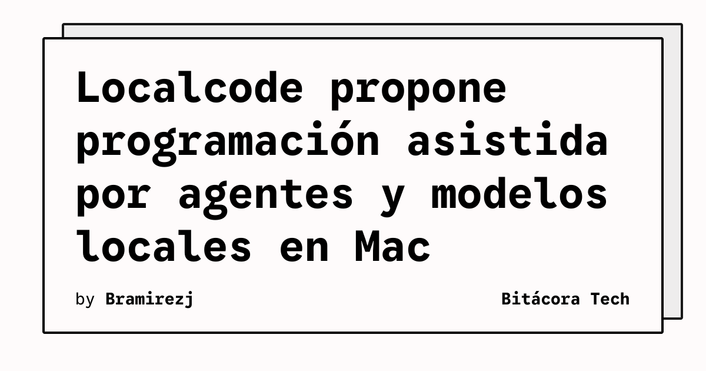

Localcode es un proyecto publicado en GitHub que se presenta como una herramienta de codificación agéntica basada en modelos locales para Mac. La ficha del repositorio resume su propuesta como «Agentic coding. Local models. On your Mac» y permite consultar el código y la documentación desde el propio proyecto.

La iniciativa aparece en el feed dentro de la categoría de código abierto. A diferencia de una plataforma cerrada, un repositorio público permite inspeccionar su implementación, revisar cambios y adaptar el flujo a las restricciones de un equipo. Eso no demuestra por sí mismo la madurez del software, pero sí ofrece un punto de partida comprobable para evaluar la herramienta.

## Qué implica

Ejecutar modelos localmente puede ser atractivo cuando el código fuente no debe salir del entorno de desarrollo o cuando la conectividad es limitada. En un flujo agéntico, esa ventaja debe equilibrarse con la capacidad del equipo, el consumo de memoria, la latencia y los permisos que se concedan al agente para leer o modificar archivos.

Antes de incorporarlo a un repositorio de producción conviene aislar el entorno, revisar las instrucciones que el agente puede ejecutar y exigir confirmación para cambios destructivos. También es útil medir el resultado con pruebas automatizadas en lugar de evaluar solo la calidad de una demostración. La disponibilidad del código facilita esa revisión, pero no la sustituye.

## Hechos confirmados

- El repositorio de GitHub se llama `localcode` y pertenece a `mjwsolo`.
- Su descripción lo presenta como una herramienta de codificación agéntica con modelos locales.
- La página del proyecto indica que está orientado a ejecutarse en Mac.

## Análisis

Localcode representa una dirección relevante para los equipos que quieren probar asistentes de programación sin delegar todo el procesamiento a un servicio remoto. El valor práctico dependerá de la documentación, la compatibilidad de modelos y la calidad de sus controles. La forma más segura de evaluarlo es comenzar con un repositorio de prueba, permisos mínimos y una comparación reproducible frente al flujo de desarrollo existente.

**Fuente:** [repositorio de localcode en GitHub](https://github.com/mjwsolo/localcode).
