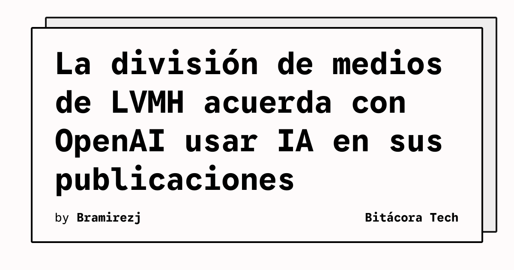

La división de medios de LVMH y OpenAI anunciaron un acuerdo para incorporar inteligencia artificial en las publicaciones del grupo y hacer más accesible su periodismo mediante ChatGPT. La alianza contempla herramientas de OpenAI y ChatGPT Enterprise para los equipos editoriales y de apoyo.

## Qué implica

El anuncio menciona casos de uso como investigar documentos, compararlos y realizar traducciones preliminares. La intención declarada es liberar tiempo para investigación, análisis y trabajo de campo, sin presentar la IA como sustituto del proceso editorial.

El acuerdo también contempla que el contenido de las marcas de la división aparezca en ChatGPT mediante resúmenes y extractos, con identificación de las fuentes y enlaces directos a los artículos originales. El despliegue se extenderá a las publicaciones del grupo y estará acompañado por formación adaptada a los distintos casos de uso.

## Hechos confirmados

- LVMH Group’s Media Division y OpenAI anunciaron un acuerdo estratégico el 16 de noviembre de 2026.
- Los equipos podrán usar herramientas de OpenAI y ChatGPT Enterprise para desarrollar aplicaciones internas.
- El anuncio cita investigación documental, comparación de documentos y traducción preliminar entre los usos posibles.
- La división reúne 17 marcas de medios, entre ellas Les Echos, Le Parisien, Challenges y Paris Match.
- OpenAI afirma que ChatGPT mostrará resúmenes y extractos con atribución y enlaces al contenido original.

La división declara que sus marcas llegan a más de 27 millones de personas en Francia cada mes y que cuenta con cerca de 700 periodistas. El contexto importa porque el acuerdo afecta tanto a flujos de trabajo internos como a la forma en que una audiencia externa encuentra y consulta contenidos periodísticos.

El comunicado presenta la formación como una parte del despliegue, junto con aplicaciones adaptadas a cada equipo. Esa combinación reconoce que el valor de una herramienta general depende de cómo se integra en los procesos, permisos y estándares de cada redacción.

## Análisis

El acuerdo combina automatización interna y distribución de contenidos en una misma negociación. Eso puede reducir trabajo repetitivo, pero también vuelve decisivas la revisión humana, la trazabilidad de las fuentes y las reglas de independencia editorial. El comunicado no detalla métricas de calidad, controles de publicación ni el calendario de despliegue, por lo que esos aspectos serán relevantes para valorar el resultado.

**Fuente:** [OpenAI](https://openai.com/index/lvmh-media-division-partnership).
