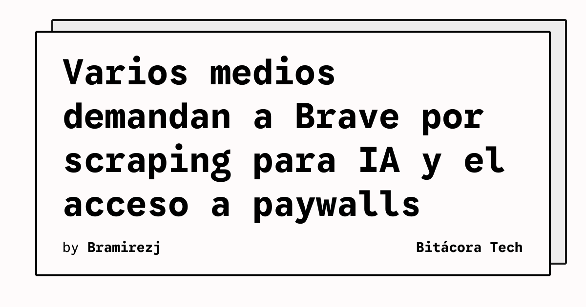

The New York Times y otras publicaciones presentaron demandas contra Brave Software por el supuesto uso ilícito de contenido rastreado para entrenar sistemas de inteligencia artificial y por facilitar el acceso a sitios con paywalls. La información fue reportada por The Verge a partir de las denuncias presentadas por las empresas editoras.

El caso pone el foco en Brave Index, el índice que el navegador ofrece a compañías de IA. Según la información publicada, los demandantes sostienen que el índice se monetiza mediante acceso de pago a contenido en línea actualizado y que puede utilizarse tanto para entrenar modelos como para responder consultas concretas.

## Qué implica

Un índice web no es solo una lista de direcciones. Puede incluir copias, metadatos y señales que permiten localizar o reconstruir información publicada por terceros. La disputa plantea qué permisos necesita una empresa cuando rastrea ese material, lo transforma en un servicio comercial y lo entrega a otros sistemas automatizados.

El conflicto también separa dos cuestiones que suelen aparecer juntas: el rastreo para construir un índice de búsqueda y el uso posterior de ese índice para generar respuestas o entrenar modelos. Las obligaciones legales y técnicas pueden diferir según el contenido, el contrato, la jurisdicción y el uso concreto.

## Hechos confirmados

- The New York Times y otras publicaciones demandaron a Brave Software.
- Las demandas alegan scraping no autorizado para entrenar IA.
- Los demandantes también cuestionan que Brave facilite el acceso a contenido protegido por paywalls.
- The Verge informa que el índice de Brave ofrece a empresas de IA acceso de pago a contenido actualizado.

## Análisis

La disputa puede acelerar la definición de controles para separar rastreo autorizado, indexación y reutilización comercial. Para los desarrolladores de buscadores y agentes, la lección inmediata es mantener registros de permisos, respetar señales de exclusión y poder demostrar qué fuente alimentó cada respuesta.

Todavía no corresponde tratar las acusaciones como hechos judicialmente probados. El resultado dependerá de los escritos completos, de la evidencia sobre el funcionamiento del índice y de la interpretación que hagan los tribunales. Mientras tanto, los equipos que construyen productos con datos web deberían documentar la procedencia y las restricciones de cada colección.

**Fuente:** [The Verge](https://www.theverge.com/tech/1024588/brave-lawsuit-ai-scraping-new-york-times).
