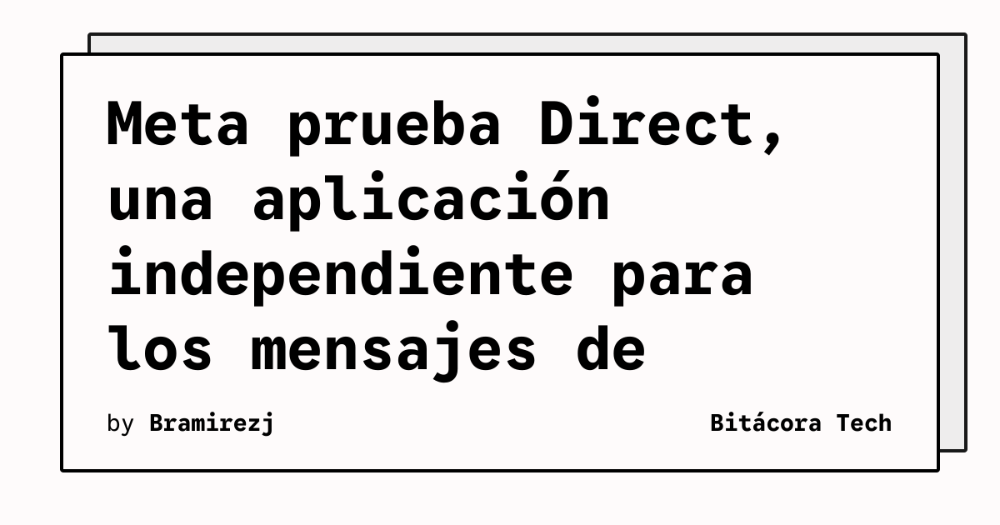

Meta está probando Direct, una aplicación independiente que reúne los mensajes directos de Instagram. El lanzamiento inicial se limita a Turquía y Tailandia, y permite registrarse con o sin una cuenta de Instagram. La propuesta separa la comunicación de la experiencia principal de la red social.

## Qué implica

Direct incluye conversaciones individuales y de grupo, reacciones, notas de voz, emojis y una función para dibujar dentro de los hilos. Las personas que ya tienen Instagram pueden iniciar sesión con sus credenciales y sincronizar sus conversaciones entre ambas aplicaciones. Meta también menciona pegatinas personalizadas, efectos de audio y temas para los fondos.

La aplicación incorpora controles de contacto, bloqueo, restricción y denuncia. Para menores, Meta afirma que aplicará la tecnología de estimación de edad y que los padres tendrán herramientas de supervisión, ajustes de seguridad y límites diarios. Los adolescentes que accedan con su cuenta de Instagram conservarán las restricciones de las cuentas para adolescentes.

## Hechos confirmados

- Meta prueba Direct inicialmente en Turquía y Tailandia.
- La aplicación puede utilizarse sin una cuenta de Instagram y permite iniciar sesión con correo electrónico o teléfono.
- Las conversaciones existentes de Instagram se sincronizan cuando la persona usa sus credenciales de Instagram.
- Meta no anunció cuándo, ni si, Direct llegará a otros países.

El despliegue limitado permite a la empresa observar cómo se comportan las cuentas que usan solo mensajería y cómo responden las familias a los controles para adolescentes. También deja abierta una cuestión de interoperabilidad: las conversaciones sincronizadas funcionan dentro de los servicios de Meta, pero el anuncio no describe conexión con redes externas. La prueba servirá para comprobar si esa promesa de simplicidad justifica mantener otra aplicación instalada.

## Análisis

Separar los mensajes puede reducir la fricción para quienes usan Instagram principalmente como servicio de comunicación. También permite a Meta conservar esa actividad dentro de su ecosistema sin exigir que la persona consuma el feed principal. El punto crítico será la confianza: la expansión tendrá que demostrar que la separación mejora el control del usuario sin convertir la mensajería en otra superficie de seguimiento o presión por crecer.

**Fuente:** [TechCrunch](https://techcrunch.com/2026/11/17/meta-launches-direct-a-standalone-messaging-app-for-instagram/).
