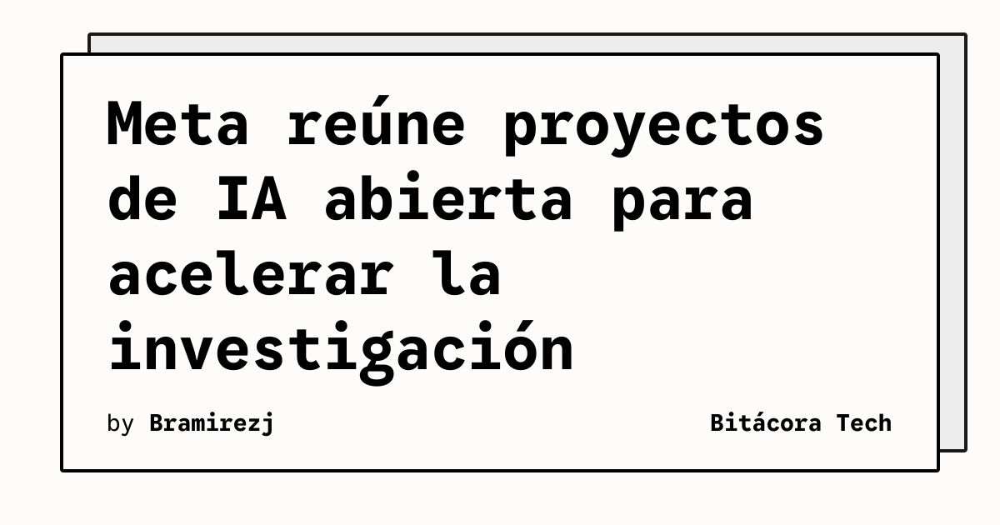

Meta organizó en Menlo Park una cumbre sobre inteligencia artificial de código abierto aplicada a la ciencia. Según la compañía, durante dos días participaron investigadores de universidades, hospitales e industria, con sesiones sobre salud, neurociencia, química, ciencia de materiales y matemáticas.

La empresa presentó una ampliación del Digital Brain Project, desarrollado con Rothschild Hospital Foundation y la Universidad de Montreal. El objetivo anunciado es financiar la recopilación y publicación abierta de datos cerebrales desidentificados. Meta elevó la meta de ese proyecto de 15.000 a 25.000 horas de datos, una cifra comunicada por la propia compañía.

También mostró trabajos de robótica asistiva de la Universidad de Pittsburgh basados en DINOv3 y SAM 3. El equipo planea demostrar un robot capaz de ayudar a una persona a comer y está experimentando con instrucciones expresadas en lenguaje natural.

## Qué implica

La cumbre presenta un modelo de investigación en el que los modelos, las herramientas y los datos compartidos forman parte del trabajo científico, no solo del producto final. El acceso abierto puede facilitar la reproducción de experimentos y la colaboración entre grupos, aunque no elimina la necesidad de controles sobre privacidad, calidad de datos y validación experimental.

En química, Meta anunció UMA Nitro, una versión más rápida de su Universal Model for Atoms. La empresa describe estudios con Carnegie Mellon y UC Riverside para identificar formas cristalinas de moléculas farmacológicas, y otro trabajo con la Universidad de Chicago para simular enzimas átomo por átomo. Son resultados y proyectos reportados por Meta, por lo que requieren evaluación independiente antes de convertirse en conclusiones generales.

## Hechos confirmados

- El encuentro reunió a investigadores de universidades, hospitales e industria.
- Meta anunció ampliar de 15.000 a 25.000 horas la meta de datos cerebrales desidentificados del Digital Brain Project.
- Un equipo de la Universidad de Pittsburgh presentó robótica asistiva basada en DINOv3 y SAM 3.
- Meta presentó UMA Nitro y una herramienta educativa llamada UMA Playground.

## Análisis

La iniciativa apunta a que la utilidad de la IA científica dependerá tanto de los modelos como de los ecosistemas de datos y validación que los rodean. El énfasis en compartir recursos puede reducir barreras de entrada, pero la apertura debe acompañarse de documentación y revisión para que los resultados sean reutilizables.

**Fuente:** [Meta Newsroom](https://about.fb.com/news/2026/11/advancing-science-together-highlights-from-the-open-source-ai-for-science-summit/).
