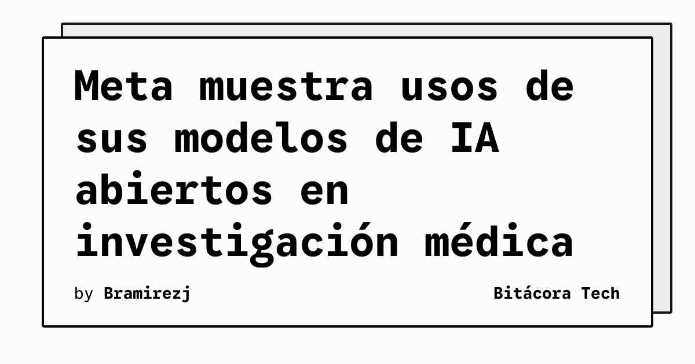

Meta reunió a investigadores en su Open Source AI For Science Summit para mostrar cómo están adaptando modelos de IA de la compañía a proyectos científicos. La publicación describe colaboraciones académicas que combinan acceso a modelos, financiación y trabajo independiente de los equipos participantes.

## Qué implica

El caso más concreto presentado por Meta se centra en la formación médica mediante realidad virtual. En la Universidad Estatal de Luisiana, el equipo de Peter DeBlieux utiliza Muse Glimmer, SAM 3, DINOv3 y otros modelos junto con visores Meta Quest 3 para desarrollar COPES, una plataforma experimental de entrenamiento para procedimientos médicos.

Según la descripción de Meta, COPES busca ofrecer orientación adaptativa, evaluación del desempeño en tiempo real y feedback personalizado. El diseño contempla aspectos técnicos, comunicación con el paciente, razonamiento clínico y toma de decisiones. La simulación permitiría practicar procedimientos en situaciones donde hacerlo con pacientes reales puede resultar arriesgado.

## Hechos confirmados

- Meta organizó un encuentro dedicado al uso de IA abierta en ciencia.
- La empresa afirma que amplió sus alianzas académicas con financiación y acceso a modelos.
- Entre los modelos citados están Muse Glimmer, SAM 3, DINOv3 y Brain2Qwertyv2.
- Un equipo de la Universidad Estatal de Luisiana desarrolla COPES con modelos de Meta y visores Meta Quest 3.
- COPES es una plataforma experimental de entrenamiento médico en realidad virtual.
- El proyecto busca proporcionar orientación adaptativa, evaluación en tiempo real y feedback personalizado.

## Análisis

El ejemplo muestra una vía distinta a la de los productos clínicos listos para uso: investigadores externos adaptan modelos generales a entornos de formación y experimentación. Esa apertura puede acelerar prototipos, pero no sustituye la validación médica, la evaluación de seguridad ni la supervisión profesional. En este caso, la palabra «experimental» es importante: los objetivos descritos por Meta todavía son metas del proyecto, no resultados clínicos demostrados.

Para los equipos técnicos, el valor estará en poder estudiar y adaptar los modelos al contexto de trabajo. Para las instituciones sanitarias, el reto será convertir esas pruebas en herramientas reproducibles, auditables y adecuadas para personas reales.

**Fuente:** [Meta Newsroom](https://about.fb.com/news/2026/11/researchers-using-meta-open-weight-ai-models-medical-breakthroughs/).
