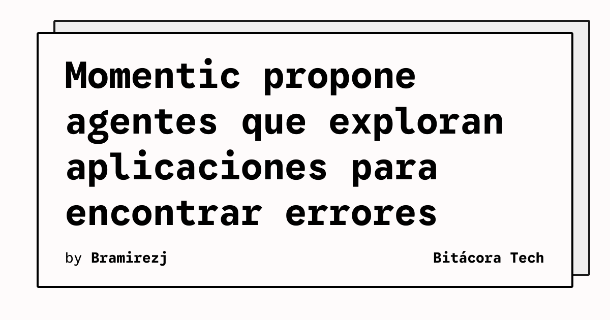

Momentic presentó agentes de control de calidad capaces de planificar recorridos, explorar interfaces y buscar errores en aplicaciones web, iOS y Android. El proyecto se dio a conocer en «Launch HN» y está orientado a equipos que necesitan probar cambios frecuentes sin limitarse a recorridos escritos de antemano.

La propuesta combina exploración automatizada con una tarea concreta: usar la aplicación como lo haría una persona y localizar fallos funcionales en sus controles y flujos. La página del proyecto describe una herramienta para equipos de ingeniería y enlaza una demostración del producto.

## Qué implica

Las pruebas tradicionales suelen depender de casos definidos por adelantado. Ese enfoque es útil para regresiones conocidas, pero puede dejar fuera combinaciones de acciones que no estaban previstas cuando se escribió el test. Un agente que explora puede ampliar ese espacio de búsqueda y señalar rutas que después deben ser reproducidas y confirmadas por el equipo.

La automatización no elimina la necesidad de criterios de calidad. Un hallazgo generado por un agente necesita contexto, pasos reproducibles y una revisión humana antes de convertirse en un defecto aceptado. También será importante separar los errores reales de los comportamientos que la aplicación considera válidos.

## Hechos confirmados

- Momentic se presenta como una herramienta de agentes de QA.
- Los agentes pueden planificar y explorar controles y flujos de usuario.
- El proyecto menciona aplicaciones web, iOS y Android, además de una futura compatibilidad con escritorio.
- La página del proyecto enlaza una demostración en vídeo.

## Análisis

La oportunidad técnica está en complementar los tests deterministas con exploración guiada por objetivos. Puede ser especialmente útil después de cambios que afectan muchos caminos de una interfaz, aunque su valor dependerá de la precisión de los informes y del tiempo necesario para validar cada hallazgo.

El anuncio no aporta todavía datos independientes sobre cobertura, tasa de falsos positivos o integración con los sistemas de entrega continua. Antes de incorporarlo a un flujo crítico, un equipo debería probarlo con una aplicación controlada, medir la reproducibilidad de sus resultados y revisar qué datos de prueba comparte con el servicio.

**Fuente:** [Momentic](https://momentic.ai/).
