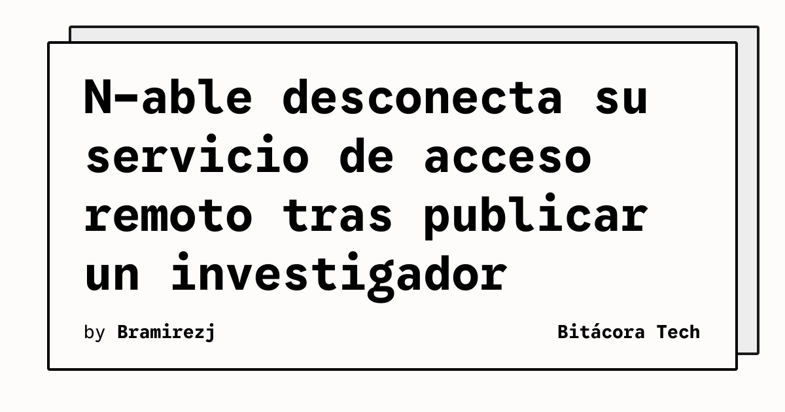

N-able dejó fuera de línea su servicio de acceso remoto después de que un investigador publicara decenas de vulnerabilidades zero-day. TechCrunch informó además de que la compañía pidió a los clientes con instalaciones autoalojadas que retiraran sus propios servidores por temor a posibles ciberataques. La historia fue publicada el 10 de noviembre de 2026 y el feed la clasificó como crítica.

La combinación de un servicio de acceso remoto y fallos todavía considerados zero-day eleva el riesgo operativo: una herramienta diseñada para administrar equipos puede convertirse en un punto de entrada si queda expuesta y no existe una corrección disponible. La respuesta descrita por la compañía prioriza reducir la superficie accesible mientras se investiga el incidente.

## Qué implica

Para los equipos que usan este tipo de plataforma, una interrupción preventiva afecta tanto a la asistencia remota como a los procedimientos de administración. El contenido de la fuente no permite afirmar qué clientes fueron comprometidos ni cuántos sistemas quedaron expuestos. Sí confirma, en cambio, que N-able recomendó retirar los servidores autoalojados y que calificó la situación como un incidente crítico de seguridad.

La medida también recuerda que la versión autoalojada no elimina la responsabilidad de proteger el perímetro. Si una organización mantiene una instancia propia, necesita inventariarla, restringir su exposición y disponer de un plan para operar sin ella cuando el proveedor recomiende desconectarla.

## Hechos confirmados

- N-able puso fuera de línea su servicio de acceso remoto.
- Un investigador publicó decenas de fallos zero-day relacionados con el servicio, según TechCrunch.
- N-able instó a sus clientes autoalojados a retirar sus servidores ante el riesgo de ciberataques.

## Análisis

La decisión de interrumpir el servicio es una señal de contención, no una prueba de que todas las instalaciones hayan sido comprometidas. La prioridad para los usuarios debe ser seguir las instrucciones oficiales, conservar registros y revisar qué accesos dependían de la plataforma. Hasta que exista información técnica adicional, conviene evitar conclusiones sobre el alcance final del incidente.

**Fuente:** [TechCrunch](https://techcrunch.com/2026/11/10/n-able-takes-its-remote-access-service-offline-after-researcher-publishes-dozens-of-zero-day-bugs/).
