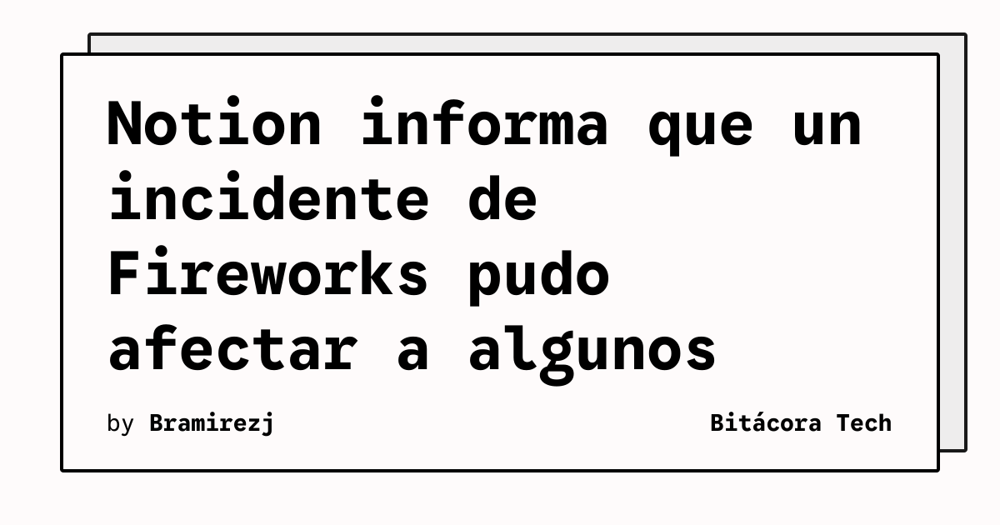

Notion publicó un aviso sobre el incidente de seguridad de Fireworks AI, uno de sus proveedores. La compañía afirma que, tras investigar el caso, menos del 1% de los espacios de trabajo de Notion pudo verse afectado. El posible alcance se limita a algunas sesiones de chat con Notion AI que no podían atribuirse a una persona o a un espacio concreto.

## Qué implica

Según el aviso de Notion, las conversaciones potencialmente expuestas no incluían la identidad de quien las escribió ni el espacio de trabajo de origen. Tampoco contenían resultados de llamadas a herramientas, como el contenido de una página de Notion o datos externos obtenidos por Notion AI. La compañía añade que no se vio afectado ningún otro dato interno de los espacios de trabajo.

Para los equipos que usan asistentes de IA con información sensible, el incidente recuerda que el riesgo no depende únicamente de la seguridad del producto principal. También alcanza a los proveedores que procesan datos durante el entrenamiento, las pruebas o la prestación del servicio. La respuesta debe considerar esa cadena completa.

## Hechos confirmados

- Notion relaciona el aviso con un incidente de seguridad en Fireworks AI.
- La investigación de Notion estima que menos del 1% de sus espacios pudo verse afectado.
- Las sesiones potencialmente expuestas eran conversaciones no atribuibles a un usuario o espacio concreto.
- Notion indica que esas transcripciones no incluían resultados de llamadas a herramientas ni otros datos del espacio de trabajo.
- La empresa recomienda rotar contraseñas, claves API u otras credenciales si alguien las pegó en Notion AI durante el periodo afectado.

El aviso también explica que participantes del programa Learning and Early Access Program (LEAP) habían ofrecido datos voluntariamente para probar tecnología de IA. Notion señala que, en el pasado, usó esos datos para experimentar con modelos específicos de tarea en Fireworks.

## Análisis

La recomendación más inmediata es revisar qué información sensible se introdujo en asistentes conectados con proveedores externos y rotar las credenciales que puedan haber aparecido allí. La comunicación de Notion no describe una exposición de páginas completas ni identifica espacios concretos, por lo que las organizaciones deberían tratar el caso como una revisión de alcance y no como una confirmación de acceso a todo su contenido.

**Fuente:** [Notion Help Center](https://www.notion.com/help/security-incident-involving-a-third-party-ai-vendor).
