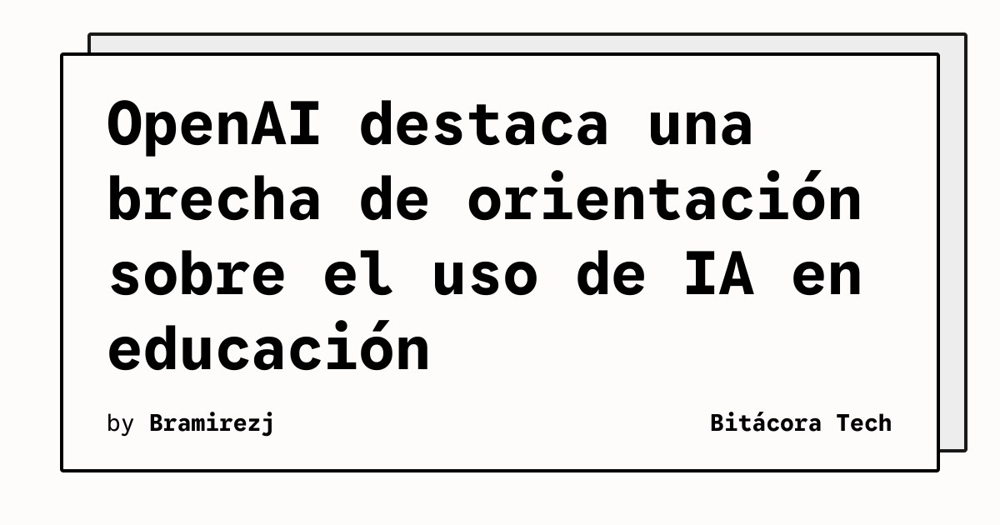

OpenAI publicó un informe sobre sus alianzas educativas en Europa, Oriente Medio y África (EMEA), con lecciones sobre apoyo a docentes, alfabetización en IA, capacidad local y evaluación. La compañía presenta estas experiencias como aprendizajes iniciales, no como un modelo único para todos los sistemas educativos.

## Qué implica

El texto sitúa a los docentes en el centro de la adopción. OpenAI sostiene que, a medida que la IA se vuelve más accesible, la experiencia, el criterio y la capacidad de orientar el aprendizaje de los profesores siguen siendo esenciales. Sus colaboraciones con gobiernos y sistemas educativos de Estonia, Eslovaquia, Grecia e Italia comparten tres prioridades: acceso equitativo a herramientas avanzadas, programas de alfabetización diseñados conjuntamente y medición continua adaptada a los idiomas, planes de estudio e instituciones locales.

El informe organiza sus observaciones alrededor de cinco temas: objetivos educativos claros, preparación de docentes, alianzas locales, alfabetización crítica en IA y evidencia creíble. También advierte que las conclusiones de cada país dependen de su contexto y de sus acuerdos particulares.

## Hechos confirmados

- OpenAI afirma trabajar con gobiernos y sistemas educativos de Estonia, Eslovaquia, Grecia e Italia, entre otros.
- La empresa identifica como prioridades el acceso equitativo, la alfabetización en IA y la evaluación continua.
- El informe cita una investigación de ThinkYoung según la cual el 79% de los estudiantes encuestados usa IA para tareas o trabajos, mientras el 47% dice haber recibido orientación sobre cómo hacerlo.
- OpenAI señala que el apoyo práctico a docentes y la adaptación a los currículos locales son elementos comunes de las experiencias revisadas.
- La compañía menciona la adopción y el ahorro de tiempo reportado por docentes como señales iniciales que requieren evaluación sostenida.

El informe también plantea que los gobiernos deben ayudar a los educadores y ofrecer expectativas más claras a los estudiantes. OpenAI dice que continuará usando encuestas, seguimiento de programas y consultas para entender experiencias, barreras y resultados.

## Análisis

La cifra de ThinkYoung apunta a un problema operativo: el uso de herramientas de IA puede extenderse más rápido que las reglas y la formación para emplearlas. Para los equipos técnicos y educativos, eso hace más útil medir prácticas concretas —qué tareas se automatizan, cómo se verifica el resultado y qué conserva el estudiante— que limitarse a declarar una política general de uso permitido o prohibido.

**Fuente:** [OpenAI](https://openai.com/index/closing-ai-guidance-gap-education/).
