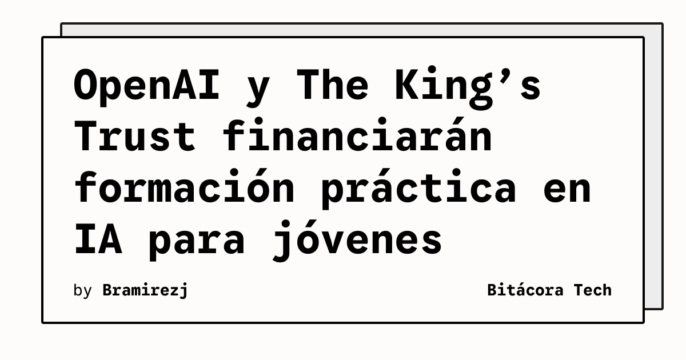

OpenAI y The King’s Trust anunciaron una alianza de un millón de libras para ayudar a jóvenes del Reino Unido a desarrollar habilidades prácticas de inteligencia artificial. El programa priorizará a quienes no estudian ni trabajan y prevé alcanzar hasta 25.000 participantes durante los próximos 18 meses.

## Qué implica

La iniciativa combina aprendizaje de IA, cualificaciones reconocidas y experiencia práctica. Según el anuncio, The King’s Trust desarrollará un programa más amplio de credenciales nacionales con participación de empleadores, especialistas en IA y jóvenes. El objetivo declarado es preparar a los participantes para oportunidades educativas y laborales en un entorno donde estas herramientas forman parte creciente del trabajo.

El acuerdo también pone el foco en un grupo que suele quedar fuera de la capacitación tecnológica. OpenAI aportará la financiación y experiencia técnica, mientras la organización benéfica incorporará el aprendizaje a sus programas de empleabilidad. La alianza se presenta como parte de un esfuerzo más amplio de OpenAI para ampliar el acceso a recursos de formación, incluida OpenAI Academy.

## Hechos confirmados

- OpenAI anunció una donación de un millón de libras a The King’s Trust.
- El programa busca llegar a hasta 25.000 jóvenes del Reino Unido en 18 meses.
- La prioridad serán jóvenes que no están en educación, empleo o formación.
- The King’s Trust trabaja en cualificaciones nacionales de IA y experiencia práctica con apoyo de empleadores y especialistas.

El anuncio sitúa la alianza en el 50.º aniversario de The King’s Trust y la vincula con una revisión independiente sobre jóvenes y trabajo. También señala que la organización ya ha apoyado a más de 1,3 millones de jóvenes, un dato institucional que ayuda a dimensionar su experiencia previa, aunque no anticipa el alcance efectivo de este nuevo programa.

## Análisis

La propuesta traslada la conversación sobre empleabilidad en IA desde el acceso a una herramienta concreta hacia la adquisición de competencias y credenciales. Su resultado dependerá de que la formación sea útil para puestos reales y de que el acompañamiento llegue a quienes enfrentan mayores barreras. El anuncio no ofrece todavía detalles sobre el plan de estudios, la evaluación ni las organizaciones empleadoras participantes.

**Fuente:** [OpenAI](https://openai.com/index/the-kings-trust-and-openai).
