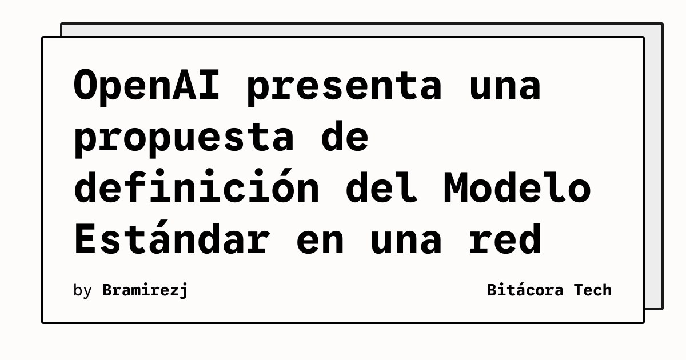

OpenAI publicó una explicación de una propuesta para definir el Modelo Estándar de la física de partículas sobre una red que representa el espacio-tiempo. El texto, escrito por el físico Nathaniel Craig, presenta una construcción candidata y describe cómo GPT-6 Astra ayudó a desarrollar una demostración detallada.

## Qué implica

Una formulación sobre una red permite estudiar la teoría con interacciones presentes desde el inicio, en lugar de tratarlas únicamente como correcciones pequeñas. El artículo explica que este enfoque, conocido como teoría de campos en red, ya ha permitido avances en el estudio de la fuerza fuerte y en el cálculo de la masa del protón desde primeros principios.

El obstáculo es que el Modelo Estándar es una teoría quiral: la interacción débil trata de forma diferente a fermiones zurdos y diestros. Una formulación directa sobre una red puede introducir compañeros de quiralidad no deseados. La propuesta descrita aborda ese problema mediante herramientas desarrolladas durante décadas, entre ellas los fermiones de solapamiento y una condición para controlar la fase de la construcción.

## Hechos confirmados

- Nathaniel Craig, investigador visitante de OpenAI, describe la propuesta en el blog científico de la compañía.
- La propuesta busca una definición no perturbativa del Modelo Estándar sobre una red de espacio-tiempo.
- El artículo afirma que GPT-6 Astra ayudó a convertir una estrategia en una construcción y a desarrollar la demostración.
- OpenAI enlaza un preprint de octubre en arXiv asociado con el trabajo.

El propio texto distingue entre una propuesta candidata y una definición ya establecida. También remite a un artículo científico asociado, de modo que la explicación divulgativa y el preprint cumplen funciones diferentes: una introduce el problema y la otra permite examinar la formulación con el detalle técnico necesario.

## Análisis

El anuncio es una contribución de investigación que todavía debe evaluarse mediante revisión y reproducción independientes. La asistencia de un modelo puede acelerar la exploración matemática, pero no sustituye la comprobación de la demostración ni la comparación con resultados previos. El interés técnico está precisamente en si la construcción resuelve de forma consistente la quiralidad y las condiciones de fase que el propio artículo identifica como dificultades.

**Fuente:** [OpenAI](https://openai.com/index/step-toward-defining-the-standard-model).
