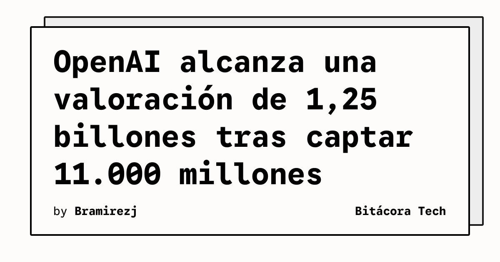

OpenAI ha alcanzado una valoración de 1,25 billones de dólares en una nueva ronda de financiación de 11.000 millones, según informó The Verge. El movimiento llega pocos días después de que Anthropic presentara documentación relacionada con una posible salida a bolsa.

## Qué implica

La nueva valoración sitúa a OpenAI entre las compañías tecnológicas privadas de mayor valor. The Verge señala que esta ronda se suma a una financiación anterior de 122.000 millones de dólares, que había valorado la empresa en 852.000 millones en marzo. La publicación también recoge que OpenAI podría buscar inversiones adicionales, aunque el importe final de la operación todavía no estaría cerrado.

El contexto financiero es especialmente relevante porque las empresas de modelos de IA compiten por capital para sostener entrenamiento, infraestructura y productos comerciales. La comparación con Anthropic añade presión competitiva en un momento en que ambas compañías buscan consolidar su posición ante inversores y clientes empresariales.

## Hechos confirmados

- The Verge atribuye a Bloomberg la información sobre una nueva ronda de 11.000 millones de dólares para OpenAI.
- La valoración comunicada para OpenAI es de 1,25 billones de dólares.
- La compañía había levantado 122.000 millones y alcanzado una valoración de 852.000 millones en marzo, según el contexto citado por The Verge.
- OpenAI habría considerado ampliar la ronda hasta 20.000 millones y anteriormente habría contemplado una cifra de 30.000 millones, pero esas opciones no representan necesariamente el cierre final.
- Anthropic se acerca a una posible salida a bolsa, según el mismo informe.

## Análisis

La cifra ilustra cuánto capital exige competir en la frontera de los modelos, pero no demuestra por sí sola rentabilidad ni una ventaja técnica permanente. El mercado tendrá que valorar si el crecimiento de ingresos y el uso empresarial pueden justificar los costes de cómputo y la concentración de financiación. La posible salida a bolsa de Anthropic podría ofrecer una referencia pública para comparar esas expectativas.

**Fuente:** [The Verge](https://www.theverge.com/ai-artificial-intelligence/1029380/openai-1-25-trillion-investment-valuation).
