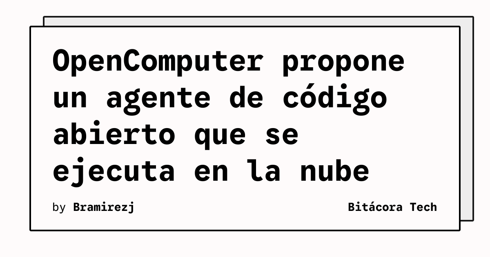

OpenComputer se presenta como una alternativa de código abierto a Devin para equipos que quieren ejecutar un agente de programación dentro de su propia cuenta cloud. El repositorio del proyecto indica que el agente y su sandbox pueden funcionar en una máquina virtual persistente de AWS, Google Cloud o Azure, en lugar de depender de una infraestructura completamente gestionada por el proveedor.

El proyecto propone un modelo operativo centrado en sesiones aisladas. Cada equipo puede tener una máquina virtual, las sesiones se separan mediante worktrees de Git y los archivos de sesión se respaldan en un repositorio después de cada turno. La documentación también afirma que una sesión puede reanudarse en otra máquina virtual cuando sea necesario.

Su motivación económica aparece ligada al tiempo de uso. El repositorio compara el coste de una máquina virtual permanente de cuatro vCPU con el de sandboxes por sesión y señala que, después de aproximadamente 640 horas mensuales, la primera opción puede resultar más barata en ciertos escenarios. Es una comparación del propio proyecto, no una medición independiente.

## Qué implica

Ejecutar el agente en una cuenta controlada por el equipo cambia la conversación sobre aislamiento, costes y continuidad. La organización conserva mayor responsabilidad sobre la red, los permisos, las imágenes de las máquinas y los datos de sesión, pero también obtiene más control sobre dónde se procesan los repositorios y cómo se recuperan los trabajos.

La persistencia puede ser útil en flujos largos: el entorno no desaparece al terminar una interacción y los archivos se pueden restaurar desde Git. Sin embargo, esa ventaja depende de configurar correctamente las credenciales, los límites de acceso y la separación entre sesiones.

## Hechos confirmados

- OpenComputer se publica como un proyecto de código abierto en GitHub.
- El proyecto está diseñado para ejecutarse en cuentas propias de AWS, GCP o Azure.
- El agente y el sandbox comparten una máquina virtual persistente.
- Las sesiones se aíslan mediante worktrees y sus archivos se respaldan en un repositorio tras cada turno.

## Análisis

La propuesta es interesante porque trata al agente como una pieza de infraestructura controlable, no solo como una interfaz web. Para equipos con requisitos de residencia de datos o necesidad de reanudar tareas, ese enfoque podría ser más atractivo. El coste real y la seguridad dependerán de la operación concreta del despliegue.

**Fuente:** [repositorio de OpenComputer en GitHub](https://github.com/diggerhq/opencomputer).
