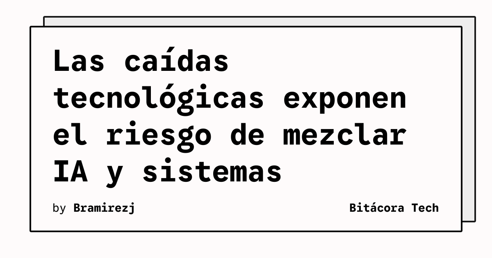

Durante las últimas dos semanas, fallos en reservas aéreas, banca y plataformas de productividad interrumpieron servicios de uso cotidiano en Estados Unidos. TechCrunch revisó la coincidencia temporal y recogió opiniones de especialistas, pero no presentó una prueba de que todos los incidentes compartan una causa. La hipótesis central apunta a la tensión entre sistemas heredados y una modernización acelerada.

## Qué implica

El artículo recuerda que Apple Pay, una red interna de la NASA, la FAA, Microsoft, Outlook, Teams y Copilot sufrieron interrupciones recientes. Varias compañías descartaron que sus problemas fueran ataques cibernéticos o ataques de IA, mientras las investigaciones continuaban. Esa distinción es importante: que una organización encuentre vulnerabilidades durante una modernización no significa que un atacante haya provocado cada caída.

Dave DeWalt, inversor y antiguo ejecutivo de seguridad, dijo que la IA puede estar descubriendo vulnerabilidades a una velocidad que obliga a las empresas a corregirlas con rapidez. Anusha Iyer, ingeniera y fundadora de Corsha, describió otro riesgo: conectar infraestructura industrial antigua con sistemas modernos sin segmentación y control suficientes.

## Hechos confirmados

- TechCrunch documentó interrupciones recientes en sistemas de aerolíneas, bancos y plataformas de productividad.
- La FAA tuvo que detener vuelos durante horas y Microsoft sufrió una caída que afectó Outlook, Teams y Copilot.
- El director de Inteligencia Nacional dijo que los incidentes no parecían relacionados con terrorismo patrocinado por Estados.
- Los expertos citados indicaron que las investigaciones seguían abiertas y que no había base para tratarlos como una campaña única de ciberataques.

## Análisis

La lección técnica no es frenar toda modernización, sino introducirla con límites verificables. Segmentación, pruebas de capacidad, despliegues graduales y planes de reversión reducen el riesgo de que un componente nuevo sobrecargue una dependencia antigua. La IA puede acelerar el hallazgo de fallos, pero la seguridad depende de cómo se priorizan y prueban las correcciones antes de llevarlas a producción.

**Fuente:** [TechCrunch](https://techcrunch.com/2026/11/19/these-tech-outages-are-giving-y2k-ai-agent-style/).
