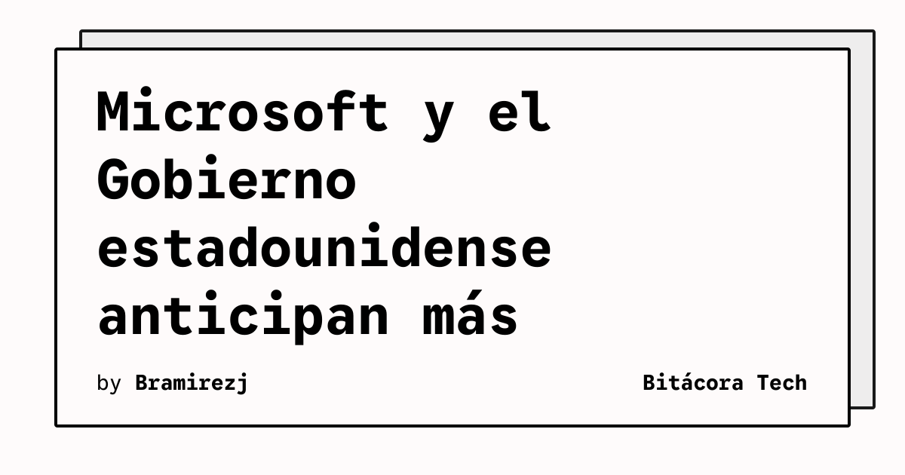

Una parada de vuelos de la FAA, una interrupción prolongada de Outlook y una caída bancaria han concentrado la atención sobre la fragilidad de los servicios digitales. The Verge recoge que el director de Inteligencia Nacional, Jay Clayton, advirtió que habrá más interrupciones mientras los sistemas se actualizan. Microsoft también señaló que los cambios importantes en tecnología pueden traer problemas durante la transición.

La advertencia no equivale a confirmar un incidente nuevo ni atribuye una causa única a los fallos mencionados. Sí describe un entorno en el que la modernización de sistemas críticos aumenta la superficie de coordinación entre proveedores, organismos y operadores.

## Qué implica

La disponibilidad no se preserva solo añadiendo servidores. Las organizaciones necesitan conocer las dependencias entre identidad, comunicaciones, pagos, redes y proveedores externos. Un cambio aparentemente acotado puede propagarse si comparte una plataforma de autenticación, una región o un procedimiento de despliegue con otros servicios.

Para los equipos de ingeniería, esto refuerza el valor de los despliegues graduales, los cambios reversibles y las pruebas de recuperación. Los indicadores deben distinguir entre una aplicación que responde y una capacidad de negocio que realmente sigue operativa. También es necesario ensayar cómo se comunica un fallo cuando los canales habituales están afectados.

## Hechos confirmados

- The Verge menciona una parada nacional de la FAA entre las interrupciones recientes.
- El artículo también cita una interrupción de varios días de Outlook y una caída bancaria de JPMorgan Chase.
- La publicación recoge declaraciones de Jay Clayton y Brad Smith sobre inversiones, actualizaciones y posibles problemas durante cambios tecnológicos.

## Análisis

La lección operativa es que la resiliencia debe medirse como una propiedad del sistema completo, no como una promesa de cada componente. Las organizaciones que actualizan infraestructura crítica deberían mantener rutas alternativas, límites de impacto y procedimientos de vuelta atrás comprobados. La predicción de más fallos no permite saber dónde ocurrirá el siguiente, pero sí justifica reducir el tiempo necesario para detectarlo y recuperarse.

**Fuente:** [The Verge](https://www.theverge.com/tech/1039851/major-tech-outages).
