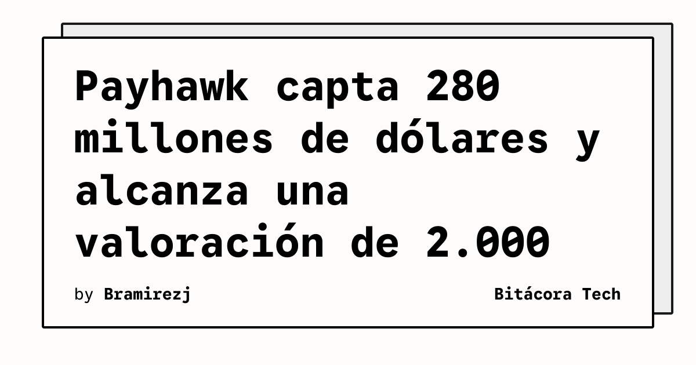

La fintech británica Payhawk anunció una ronda Serie C de 280 millones de dólares liderada por el brazo de crecimiento de Goldman Sachs. Según TechCrunch, la operación valora la compañía en 2.000 millones de dólares y eleva su financiación acumulada por encima de 500 millones.

## Qué implica

Payhawk desarrolla una plataforma de gestión financiera empresarial para controlar gastos y compras. La compañía presenta su producto como una combinación de agentes de inteligencia artificial, infraestructura de pagos y controles para equipos financieros.

El capital llega en un momento en que las startups de gestión de gastos compiten por automatizar tareas que antes requerían revisiones manuales. En este tipo de software, el reto no es únicamente generar recomendaciones: los agentes deben operar dentro de políticas contables, permisos y registros que permitan auditar sus decisiones.

## Hechos confirmados

- Payhawk anunció una ronda Serie C de 280 millones de dólares.
- Goldman Sachs lideró la operación, según el artículo de TechCrunch.
- La ronda sitúa la valoración de la compañía en 2.000 millones de dólares.
- La empresa fue fundada en 2018 y afirma operar en 33 países.
- TechCrunch informó que Payhawk conserva el 70 % de los 100 millones de dólares captados en 2022, cuando su valoración era de 1.000 millones.

## Análisis

La ronda refleja el interés inversor por herramientas que integran automatización y controles financieros. La validación del producto dependerá de algo más que la financiación: las empresas necesitarán precisión, trazabilidad y límites claros antes de delegar pagos o decisiones de compras a agentes. Para Payhawk, la expansión internacional será también una prueba de adaptación a distintas reglas, procesos y niveles de madurez digital.

La ronda llega además con una señal sobre el posicionamiento de la empresa. Payhawk no presenta la IA como una función aislada, sino como una capa dentro de un sistema que combina pagos, compras y controles empresariales. Ese enfoque puede ser atractivo para clientes que prefieren reducir el número de herramientas, aunque también concentra más responsabilidad en una sola plataforma.

El crecimiento internacional obligará a demostrar que la automatización puede convivir con auditorías y políticas locales. La capacidad de explicar por qué un agente propuso o ejecutó una acción será tan importante como la velocidad con la que procese una factura o clasifique un gasto.

**Fuente:** [TechCrunch](https://techcrunch.com/2026/11/18/spend-management-platform-payhawk-announces-280m-raise-2b-valuation/).
