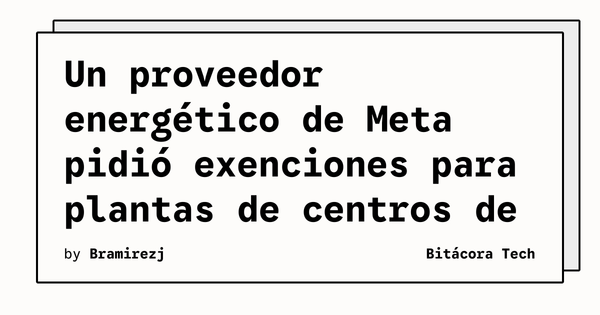

La expansión de los centros de datos está trasladando parte de la discusión tecnológica hacia la generación eléctrica. Wired informa que Williams, proveedor de gas para centros de datos de Meta, pidió a los reguladores eximir determinadas plantas de las reglas de lluvia ácida. El artículo añade que la Agencia de Protección Ambiental de Estados Unidos había recomendado flexibilizar esas reglas para ciertas instalaciones y que antes se reunió con actores de la industria.

El asunto no trata solo de cuánto cómputo puede instalar una compañía. También afecta a la arquitectura física que sostiene los modelos y servicios digitales: disponibilidad de energía, permisos, emisiones y capacidad de conexión se convierten en restricciones del diseño de infraestructura.

## Qué implica

Los operadores de plataformas deben incorporar el origen de la energía y sus requisitos regulatorios al planificar nuevas regiones o ampliaciones. Una planta dedicada a respaldar un centro de datos puede reducir la dependencia de la red en determinados escenarios, pero también puede añadir obligaciones ambientales, costes de cumplimiento y riesgo reputacional.

Para los equipos técnicos, esta tensión puede cambiar decisiones aparentemente alejadas de la regulación. La ubicación de una carga de trabajo, la contratación de capacidad eléctrica y el uso de mecanismos de respaldo terminan influyendo en latencia, continuidad y coste. En consecuencia, la planificación de capacidad necesita coordinarse con especialistas en energía y asuntos públicos, no solo con ingeniería de plataforma.

## Hechos confirmados

- Wired identifica a Williams como proveedor de gas para centros de datos de Meta.
- El artículo señala que Williams pidió a los reguladores eximir ciertas plantas de las reglas de lluvia ácida.
- La publicación informa que la EPA se reunió con actores de la industria antes de recomendar una exención para determinadas plantas eléctricas de centros de datos.

## Análisis

La noticia muestra que el crecimiento de la IA depende de decisiones sobre infraestructura que no se resuelven en una consola cloud. Las exenciones pueden facilitar capacidad en el corto plazo, pero el coste total debe incluir emisiones, permisos y exposición a cambios regulatorios. Para los operadores, medir esa dependencia desde el principio es más prudente que tratarla como un problema posterior al despliegue.

**Fuente:** [Wired](https://www.wired.com/story/a-power-provider-for-meta-urged-regulators-to-exempt-data-center-plants-from-acid-rain-rules/).
