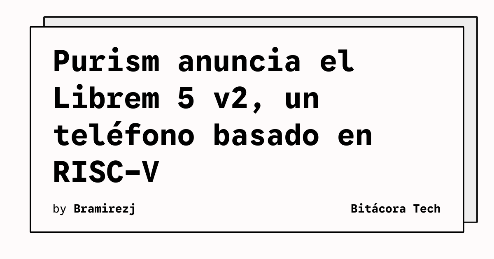

Purism anunció el Librem 5 v2, un teléfono basado en la arquitectura RISC-V. La presentación coloca el dispositivo dentro de la apuesta de la empresa por ofrecer un sistema móvil donde el usuario tenga más control sobre el hardware, el software y la privacidad.

## Qué implica

RISC-V es una arquitectura de conjunto de instrucciones abierta. Su presencia en un teléfono comercial puede interesar a desarrolladores que trabajan con sistemas embebidos, distribuciones Linux y herramientas de bajo nivel. Sin embargo, la arquitectura por sí sola no garantiza una experiencia móvil completa: también importan los controladores, el soporte gráfico, la autonomía, el módem y la disponibilidad de aplicaciones.

La estrategia de Purism apunta a un público dispuesto a valorar la auditabilidad y la libertad de modificación aunque eso implique aceptar un ecosistema más pequeño. Para las comunidades de software libre, cada dispositivo de este tipo puede aportar documentación, parches y pruebas que beneficien a proyectos posteriores.

El anuncio merece atención también por la cadena de suministro. Un teléfono abierto necesita que el fabricante publique información suficiente para que la comunidad pueda depurar problemas y mantener el sistema durante años. La disponibilidad de piezas y la actualización de componentes serán tan importantes como la elección de RISC-V.

## Hechos confirmados

- Purism anunció el Librem 5 v2 en una publicación de su sitio oficial.
- El teléfono utiliza RISC-V, una arquitectura abierta.
- El anuncio presenta el dispositivo como una herramienta para ampliar el control de las personas sobre su tecnología.
- El feed clasificó la noticia como tecnología emergente y prioridad alta. Sin un calendario claro de soporte, la apertura inicial perdería valor para quienes buscan usar el teléfono como plataforma duradera.

## Análisis

El interés del Librem 5 v2 dependerá de la distancia entre la promesa de apertura y el soporte diario que logre ofrecer. Para desarrolladores, será importante revisar qué partes del sistema pueden compilarse, auditarse y reemplazarse, y cuáles dependen de componentes cerrados. El proyecto puede ser valioso aunque no compita por volumen con Android o iOS, siempre que convierta su enfoque en documentación y mantenimiento sostenidos.

**Fuente:** [Purism](https://puri.sm/posts/purism-launches-librem-5-v2-a-risc-v-phone/).
