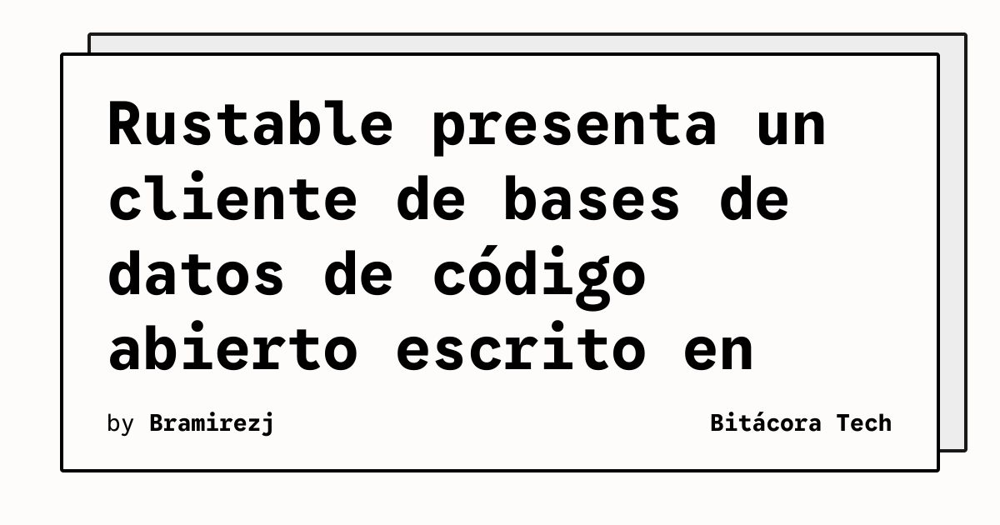

Rustable se presenta como un cliente de bases de datos de código abierto construido en Rust. El proyecto apareció en la sección «Show HN» de Hacker News y enlaza con su sitio oficial, donde se describe la herramienta. A diferencia de una noticia basada únicamente en una mención de agregador, el enlace del proyecto abre directamente la página del producto.

## Qué implica

Un cliente de bases de datos concentra en una interfaz las tareas de conexión, exploración y consulta que normalmente se realizan con herramientas separadas. Que Rustable esté escrito en Rust sitúa el proyecto dentro de una comunidad que busca binarios nativos y una base de código con las garantías de seguridad de memoria del lenguaje. Esas características describen una dirección técnica, no prueban por sí mismas que el programa sea más rápido o más seguro para cualquier carga.

El carácter abierto del proyecto también permite inspeccionar su código y evaluar su evolución. Para un equipo técnico, esa posibilidad importa tanto como la interfaz: facilita revisar dependencias, comprobar el soporte de motores y decidir si la herramienta encaja en un flujo de trabajo existente.

## Hechos confirmados

- Rustable se anuncia como un cliente de bases de datos de código abierto.
- El proyecto está construido en Rust.
- La historia fue publicada en «Show HN» el 3 de noviembre de 2026.
- El enlace primario del proyecto es `https://rustable.app` y respondió con HTTP 200.

## Análisis

El interés de Rustable no depende solo de reemplazar otro cliente. La oportunidad está en reunir una experiencia de administración de datos con un ejecutable nativo y un desarrollo que la comunidad pueda revisar. Para que esa propuesta resulte útil a largo plazo, el proyecto tendrá que demostrar compatibilidad suficiente con los motores que usan los equipos, mantener conexiones previsibles y documentar cómo protege credenciales y consultas.

El anuncio disponible no especifica todos los motores compatibles, el estado de producción ni el modelo de distribución. Conviene evaluar esas piezas antes de adoptarlo en entornos operativos. La licencia, la actividad del repositorio y la gestión de secretos deberían formar parte de esa revisión.

**Fuente:** [Rustable](https://rustable.app/).
