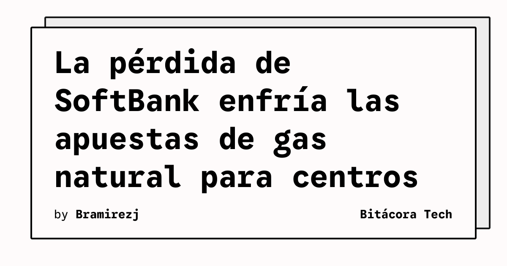

La expansión de la inteligencia artificial también se está convirtiendo en una apuesta energética. TechCrunch informa que SoftBank perdió más de 3.000 millones de dólares después de reservar por adelantado turbinas de gas natural destinadas a centros de datos de IA. El medio analiza el episodio como una posible señal de límite para las ambiciones de construir nueva capacidad eléctrica alrededor del gas.

El dato confirmado es el tamaño de la pérdida descrita por la fuente y su relación con turbinas preordenadas para alimentar centros de datos. La noticia no permite concluir que la demanda de infraestructura de IA haya desaparecido ni que todas las inversiones en generación a gas estén en riesgo. Sí muestra que anticipar capacidad energética con demasiada rapidez puede convertir una previsión de crecimiento en un coste financiero considerable.

## Qué implica

Los centros de datos necesitan energía continua, y los proyectos de IA suelen planificarse con horizontes más largos que los ciclos de producto de un modelo. Esa diferencia crea un problema de coordinación: una empresa puede comprometer equipos y contratos antes de que exista certeza sobre la ubicación, la escala o el ritmo de ocupación de los centros.

Para los operadores cloud, la electricidad deja de ser una partida secundaria. La disponibilidad de red, los plazos de conexión, el combustible y la flexibilidad de las turbinas pueden condicionar qué cargas de IA son viables y cuánto cuesta ejecutarlas. La infraestructura que no se usa no solo representa capital inmovilizado; también puede alterar los supuestos con los que se calculan precios y capacidad.

## Hechos confirmados

- TechCrunch reporta una pérdida de más de 3.000 millones de dólares para SoftBank.
- El desembolso estuvo relacionado con la reserva anticipada de turbinas de gas natural.
- Las turbinas estaban destinadas a suministrar energía a centros de datos de inteligencia artificial.

## Análisis

El episodio sugiere que la carrera por asegurar energía puede necesitar compromisos más escalonados. Reservar capacidad por fases, vincular compras a hitos de demanda y comparar alternativas de red puede reducir el riesgo de sobreconstrucción. No es una prueba de que el gas sea inviable para la IA, sino una advertencia sobre el coste de convertir una proyección tecnológica en una infraestructura rígida antes de validar el mercado.

**Fuente:** [TechCrunch](https://techcrunch.com/2026/11/12/softbanks-billion-dollar-loss-may-have-put-a-cap-on-ais-natural-gas-ambitions/).
