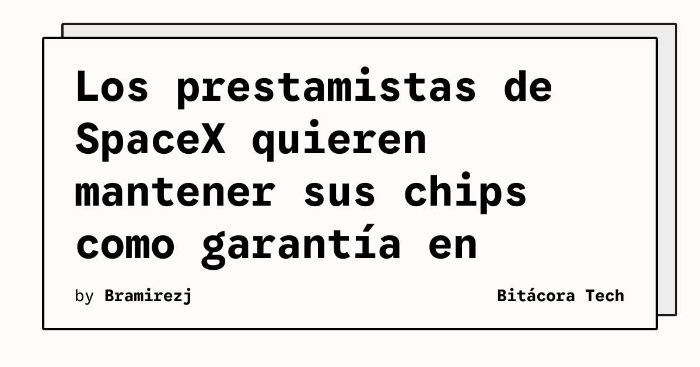

Los activos de hardware no solo tienen valor cuando funcionan dentro de un producto: también pueden convertirse en garantías de financiación. Ars Technica informa que los tenedores de bonos de SpaceX quieren que los chips valiosos ofrecidos como colateral permanezcan en la Tierra y al alcance de los acreedores, en lugar de ser enviados al espacio.

El conflicto expone una tensión particular de las empresas espaciales. Un activo puede ser estratégico para una misión y, al mismo tiempo, representar una parte relevante de la protección que espera un prestamista. Cuando ese activo abandona la Tierra, recuperarlo, inspeccionarlo o venderlo deja de ser una operación comparable a la de un equipo almacenado en una instalación convencional.

La noticia no presenta el caso como un debate abstracto sobre la exploración espacial. Lo sitúa en las condiciones concretas de una financiación respaldada por hardware. La preocupación central de los bonistas es conservar el colateral en un lugar accesible y controlable.

## Qué implica

Para las compañías de infraestructura, el episodio recuerda que la ingeniería y las finanzas comparten dependencias. Una pieza puede ser indispensable para una misión, pero su tratamiento contractual determina si también puede respaldar deuda. Esa consideración afecta la planificación de inventario, los seguros, los calendarios de lanzamiento y las cláusulas de incumplimiento.

El caso también ilustra una diferencia entre propiedad y recuperabilidad. Tener derechos sobre un activo no equivale necesariamente a poder recuperarlo con rapidez si está integrado en una misión o sometido a condiciones operativas especiales. Los prestamistas parecen estar pidiendo que la garantía conserve una recuperabilidad práctica.

## Hechos confirmados

- Los acreedores mencionados por Ars Technica son tenedores de bonos de SpaceX.
- La garantía incluye chips descritos como valiosos.
- Los bonistas quieren que esos chips permanezcan en la Tierra y dentro de su alcance.
- La disputa se relaciona con el riesgo de que Elon Musk lance al espacio activos usados como garantía.

## Análisis

La historia muestra que los activos espaciales necesitan una definición financiera tan precisa como su especificación técnica. A medida que las empresas financien misiones con equipos de alto valor, las condiciones sobre dónde puede estar la garantía podrían influir en qué hardware se lanza y cuándo. Es una posible consecuencia contractual, no una predicción sobre el resultado de esta disputa.

**Fuente:** [Ars Technica](https://arstechnica.com/space/2026/11/spacex-lenders-dont-want-elon-musk-launching-their-collateral-into-space/).
