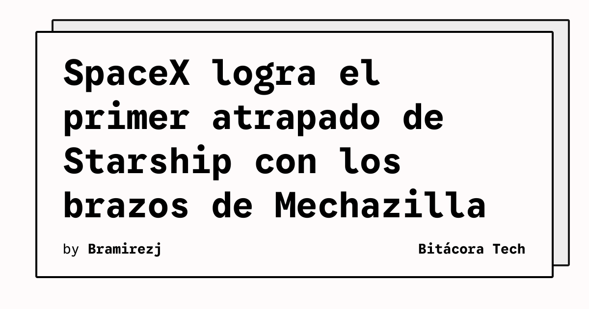

SpaceX consiguió una maniobra inédita durante el vuelo 15 de Starship: la torre Mechazilla atrapó la nave con sus brazos, conocidos como «chopsticks». La empresa ya había ensayado atrapados de propulsores, pero esta es la primera vez que el sistema recibe con éxito al vehículo Starship.

## Qué implica

El resultado valida una parte importante de la estrategia de reutilización de SpaceX. La nave descendió entre las nubes, se colocó en posición vertical y quedó sostenida por los brazos de la torre. El procedimiento pretende evitar una plataforma de aterrizaje convencional y concentra la recuperación junto a la infraestructura de lanzamiento.

El vuelo no terminó con la recuperación completa del conjunto. El propulsor abortó su aterrizaje y detonó sobre el golfo de México, según la información publicada por The Verge. La compañía todavía intenta determinar la causa de esa interrupción. Por eso, el atrapado de la nave es un hito parcial, no una demostración de recuperación integral.

La secuencia también demuestra que la infraestructura terrestre forma parte del vehículo operativo. El éxito depende de coordinar lanzamiento, guiado, descenso y captura en una misma ventana. Una anomalía en el propulsor puede arruinar la reutilización aunque la nave llegue correctamente a la torre, de modo que ambos resultados técnicos deben evaluarse por separado.

## Hechos confirmados

- Mechazilla atrapó Starship por primera vez con sus brazos de lanzamiento y recuperación.
- SpaceX ya había realizado atrapados de propulsores en vuelos anteriores.
- El propulsor de este vuelo no completó el aterrizaje y detonó sobre el golfo de México.
- Elon Musk había advertido que el éxito de estos primeros vuelos no estaba garantizado.

## Análisis

La prueba separa dos problemas técnicos que a menudo se presentan como uno solo: colocar la nave en la torre y recuperar el propulsor. El primero avanzó de forma visible, mientras que el segundo sigue abierto. Si SpaceX identifica la causa del aborto y conserva la precisión del atrapado, la arquitectura podría reducir operaciones entre vuelos. Todavía faltan más ensayos para saber si la maniobra funciona con la regularidad que exige una cadencia alta.

**Fuente:** [The Verge](https://www.theverge.com/science/1033930/spacex-chopstick-starship-catch).
