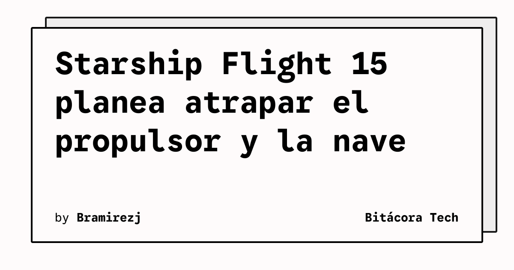

SpaceX prepara Starship Flight 15 para el 13 de noviembre con un objetivo especialmente exigente: intentar recuperar mediante captura tanto el propulsor como la nave. La fecha y el plan aparecen en la página oficial de lanzamientos de SpaceX, que funciona como fuente primaria para esta misión.

La propuesta concentra en un mismo vuelo dos maniobras de recuperación. En lugar de limitarse a dejar que las etapas desciendan por separado, el plan busca que los sistemas de la torre intervengan en la captura de los vehículos después de sus respectivas fases de vuelo.

## Qué implica

La captura simultánea exige coordinar el lanzamiento, la separación, las trayectorias de retorno y la operación de la torre. También obliga a que el propulsor y la nave lleguen a sus zonas de recuperación dentro de márgenes compatibles con la maniobra.

El plan es un objetivo de misión, no una confirmación de que la captura vaya a completarse. La ejecución dependerá de las condiciones del vuelo y de los criterios de seguridad de SpaceX. Por eso, la fecha anunciada debe entenderse como una planificación sujeta a cambios, no como una garantía de lanzamiento.

Desde el punto de vista de ingeniería, el interés está en la integración del ciclo completo. Una recuperación de ambas partes podría aportar información sobre la reutilización coordinada de un sistema pesado, mientras que un intento fallido también permitiría evaluar los límites de la arquitectura y de los procedimientos de retorno.

## Hechos confirmados

- SpaceX identifica la misión como Starship Flight 15.
- La página oficial de la misión indica el 13 de noviembre como fecha planificada.
- El objetivo descrito para el vuelo contempla intentar atrapar el propulsor y la nave.
- La fecha y el resultado pueden cambiar según la preparación del vehículo y las condiciones de seguridad.

## Análisis

La importancia de Flight 15 no está solo en alcanzar la órbita o completar una trayectoria. El elemento diferencial del plan es probar una recuperación coordinada de los dos vehículos principales. Si la operación avanza, ofrecerá una demostración más completa de la estrategia de reutilización de SpaceX; si se modifica o se pospone, seguirá siendo una señal de la complejidad técnica que implica cerrar ese ciclo.

**Fuente primaria:** [SpaceX, Starship Flight 15](https://www.spacex.com/launches/starship-flight-15).
