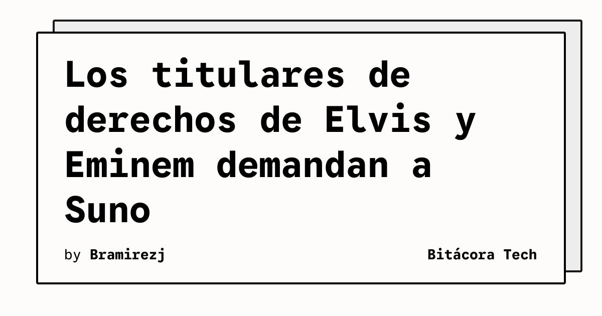

Suno enfrenta nuevas demandas relacionadas con la generación musical mediante inteligencia artificial. Los titulares de los derechos de la música de Elvis Presley y el editor de parte del catálogo de Eminem han presentado acciones legales contra la compañía, según *The Verge*.

Las demandas sostienen que Suno puede generar música y letras que imitan a esos artistas. La disputa se centra en el uso de identidades creativas y rasgos reconocibles de intérpretes dentro de un sistema capaz de producir canciones a partir de instrucciones del usuario.

## Qué implica

El caso añade presión legal a un área en la que los modelos generativos pueden reproducir elementos asociados con artistas concretos. No se trata únicamente de discutir si una salida se parece a una canción existente: las reclamaciones también abordan la voz, la identidad y la capacidad de evocar de manera deliberada a una persona conocida.

La demanda relacionada con Elvis invoca la ley de Tennessee conocida como ELVIS Act, que restringe la clonación de la voz y la imagen de un cantante por parte de una empresa de inteligencia artificial. Los representantes de los titulares de derechos alegan que Suno habría incorporado las identidades de artistas y su trabajo en el funcionamiento del servicio.

El resultado no está resuelto por la presentación de las demandas. La responsabilidad dependerá de los hechos que puedan probarse y de cómo los tribunales interpreten la relación entre entrenamiento, generación, imitación y derechos de personalidad.

## Hechos confirmados

- Los titulares de derechos de Elvis Presley y el editor de parte del catálogo de Eminem demandaron a Suno.
- Las reclamaciones sostienen que el servicio genera música y letras que imitan a esos artistas.
- La demanda de los titulares de Elvis menciona la ley ELVIS de Tennessee.
- Los representantes de Presley alegan que la empresa codificó identidades y trabajo creativo de artistas en su sistema.

## Análisis

Estas acciones legales pueden definir qué controles deben aplicar los servicios de generación musical cuando una petición apunta a un artista identificable. Para las empresas de IA, la cuestión práctica será demostrar que sus modelos no convierten una identidad artística en una función reproducible sin autorización. Para los titulares de derechos, el desafío será delimitar qué parte de una imitación constituye una infracción y qué parte pertenece a la expresión permitida.

**Fuente:** [The Verge](https://www.theverge.com/ai-artificial-intelligence/1029533/elvis-eminem-suno-ai-music-clone-lawsuit).
