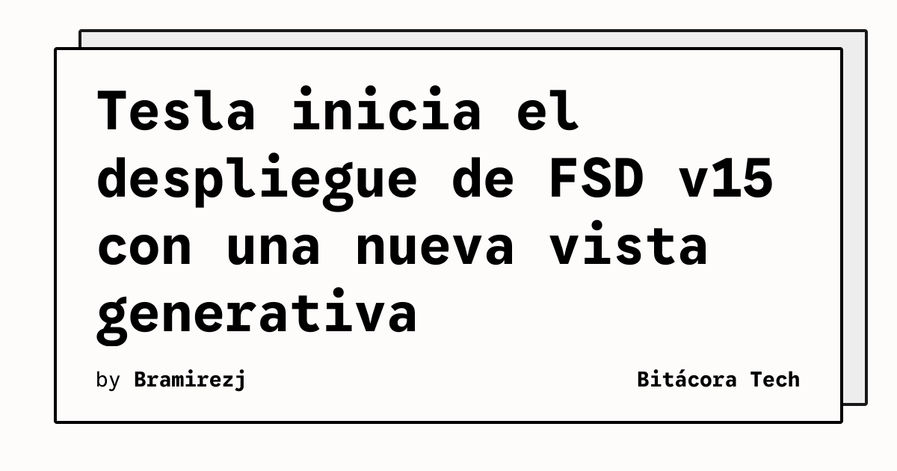

Tesla comenzó a desplegar Full Self-Driving (Supervised) v15, que la compañía presenta como una revisión profunda de su sistema de asistencia a la conducción. La actualización incorpora Reality View, una representación generativa en tiempo real que muestra una perspectiva elevada del entorno y permite interactuar con el plan del vehículo.

## Qué implica

La interfaz sustituye los antiguos gráficos de líneas por una escena que representa edificios, cruces, peatones y tráfico. La vista recuerda a la estética de un videojuego, aunque su función declarada es ayudar al conductor a entender lo que el sistema está procesando. Tesla también incorpora cambios prácticos en el control de accesorios, las cámaras de velocidad, la navegación y la atención del conductor.

El despliegue no afecta de igual manera a toda la flota. El artículo indica que FSD v15 está pensado para vehículos con hardware AI4, además de plataformas futuras como Cybercab. Los automóviles equipados con hardware HW3 quedan fuera de estas capacidades, según la información publicada.

## Hechos confirmados

- Tesla inició el despliegue de Full Self-Driving (Supervised) v15.
- Reality View ofrece una visualización generativa en tiempo real con perspectiva elevada.
- El sistema incluye un modo Bike Rack para usar FSD con accesorios de enganche, aunque desactiva reversa, Summon y Autopark.
- La actualización añade ajustes ante cámaras de velocidad y mejoras anunciadas para baches, agua acumulada, animales pequeños y zonas escolares.
- Tesla afirma que el modelo utiliza un codificador de visión actualizado compartido por FSD, Robotaxi y Optimus.
- FSD v15 está orientado a vehículos con hardware AI4 y no a los millones de vehículos con HW3 descritos en el artículo.

## Análisis

La nueva interfaz hace visible una tensión habitual en los sistemas asistidos: una visualización más detallada puede mejorar la comprensión, pero también distraer. Tesla incluye una vista de solo mapa y una opción más simple para quienes no quieran la representación completa. La evaluación importante será si esas alternativas ayudan a mantener la atención en la carretera, no si la interfaz resulta llamativa.

La separación entre AI4 y HW3 también convierte la actualización en una cuestión de compatibilidad de hardware. El cambio no es únicamente de software: para parte de la flota, las nuevas funciones pueden quedar fuera aunque el vehículo siga recibiendo otras actualizaciones.

**Fuente:** [The Verge](https://www.theverge.com/transportation/1039919/tesla-fsd-v15-reality-view-gta-nhtsa-safety-rollout).
