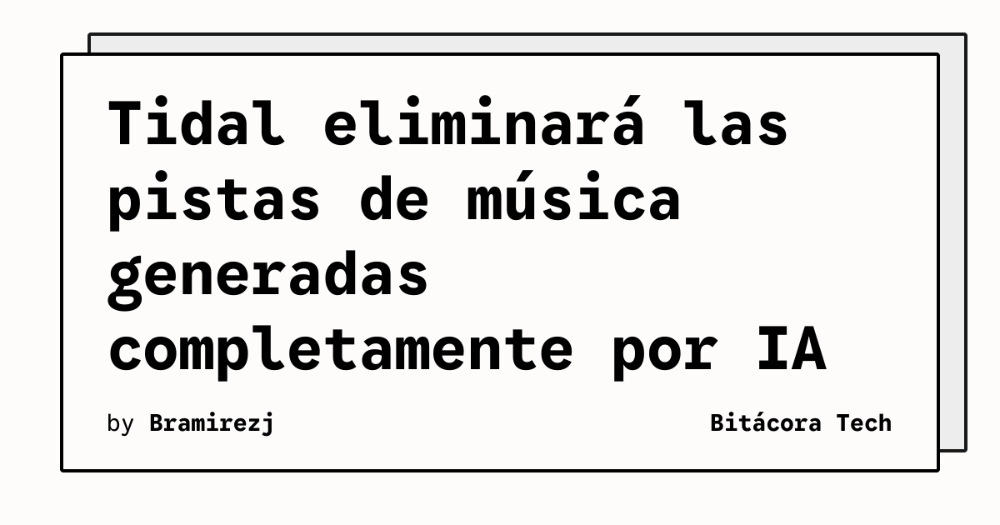

Tidal anunció que prohibirá las pistas musicales generadas completamente por inteligencia artificial y que las retirará de su catálogo el 9 de diciembre. Ars Technica informa que esas canciones representan el 6,3 % del catálogo del servicio, una proporción suficientemente grande como para convertir la decisión en un cambio operativo y no solo editorial.

La medida distingue entre el uso de herramientas de IA dentro de un proceso creativo y las pistas generadas por completo por un sistema. Esa separación es importante para una plataforma que debe aplicar sus reglas a un catálogo masivo, identificar el origen de las obras y comunicar qué material continuará disponible.

## Qué implica

Para una plataforma de streaming, retirar un conjunto de obras requiere más que cambiar una política. También implica detectar contenido, resolver reclamaciones y actualizar metadatos. La decisión de Tidal pone el foco en la definición de «generado completamente por IA», porque una regla demasiado amplia podría incluir trabajos con asistencia algorítmica y una regla demasiado estrecha sería difícil de aplicar de forma consistente.

El porcentaje citado por Ars Technica ofrece una medida del alcance: no se trata de una excepción marginal. La retirada puede afectar a artistas, distribuidores y usuarios que ya incorporaron esas pistas a sus bibliotecas o listas. La fuente, sin embargo, no convierte la cifra de catálogo en una estimación de reproducciones ni de ingresos.

## Hechos confirmados

- Tidal anunció una prohibición para las pistas generadas completamente por IA.
- La fecha comunicada para eliminar esas pistas es el 9 de diciembre.
- Ars Technica cifra en 27 millones las pistas afectadas y en 6,3 % su peso dentro del catálogo.

## Análisis

El caso muestra que las plataformas están pasando de debatir la autenticidad de la música sintética a diseñar reglas de catálogo. La dificultad central será la trazabilidad: el servicio necesita una clasificación que pueda aplicar a grandes volúmenes y explicar cuando un creador la cuestione. El impacto final dependerá de cómo Tidal defina las excepciones y de si otros servicios adoptan criterios parecidos.

**Fuente:** [Ars Technica](https://arstechnica.com/ai/2026/11/tidal-will-ban-fully-ai-generated-music-on-december-9/).
