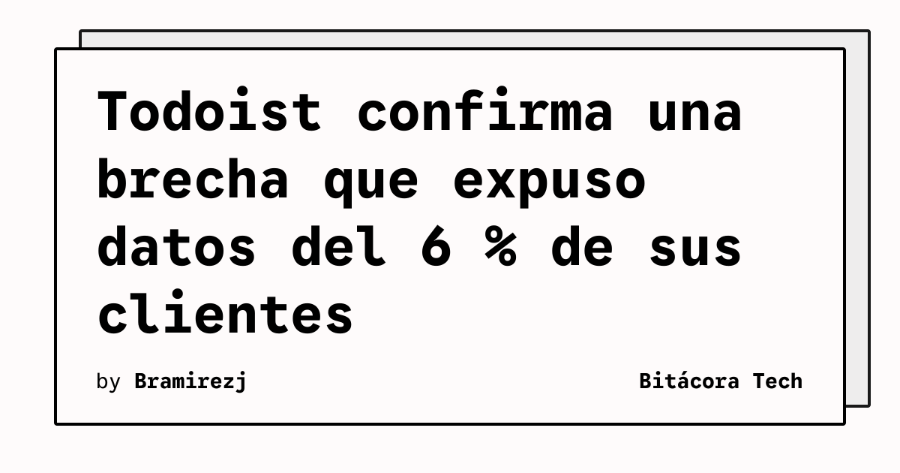

Todoist confirmó que un atacante accedió a sus sistemas de producción y robó datos de clientes. TechCrunch informó que el incidente afectó al 6 % de la base de usuarios y que la información sustraída incluye identificadores de correo electrónico, hashes de contraseñas y fechas de creación de cuentas.

La propia Todoist publicó una explicación del incidente y puso el aviso a disposición de sus usuarios. La comunicación oficial es la referencia para conocer las medidas específicas. La información disponible no indica que las contraseñas en texto plano formen parte de los datos robados; el hecho confirmado es la exposición de hashes. La diferencia importa para evaluar el riesgo con precisión. Aun así, la combinación de correos y material relacionado con autenticación requiere una respuesta preventiva por parte de los usuarios potencialmente afectados.

## Qué implica

Un hash no equivale automáticamente a una contraseña recuperable, pero su seguridad depende del algoritmo, los parámetros y la resistencia de la contraseña original. Una cuenta reutilizada en otros servicios puede convertir una filtración parcial en un riesgo más amplio, aunque esos otros servicios no hayan sido comprometidos.

Los equipos de seguridad deberían tratar el incidente como una oportunidad para revisar las dependencias de autenticación. La rotación de credenciales, el uso de contraseñas únicas y la autenticación multifactor reducen el impacto de una posible reutilización o de campañas de suplantación que aprovechen los correos expuestos.

## Hechos confirmados

- Todoist comunicó que un atacante accedió a sistemas de producción.
- La empresa indicó que fueron afectados datos del 6 % de sus clientes.
- Los datos mencionados incluyen identificadores de correo, hashes de contraseñas y fechas de creación de cuentas.

## Análisis

El incidente muestra por qué la segmentación de datos y la protección del plano de producción importan incluso en servicios de productividad. La prioridad para los usuarios es no reutilizar credenciales y verificar las comunicaciones desde los canales oficiales. Para los proveedores, la transparencia sobre el alcance y la naturaleza exacta de los datos permite que cada cliente tome medidas proporcionales, sin convertir una brecha confirmada en especulación adicional.

**Fuente:** [TechCrunch](https://techcrunch.com/2026/11/25/todoist-confirms-6-of-customers-details-were-stolen-in-data-breach/) y [comunicado de Todoist](https://www.todoist.com/help/todoist/get-started/security-incident-in-november-2026-cG0EIACNU).
