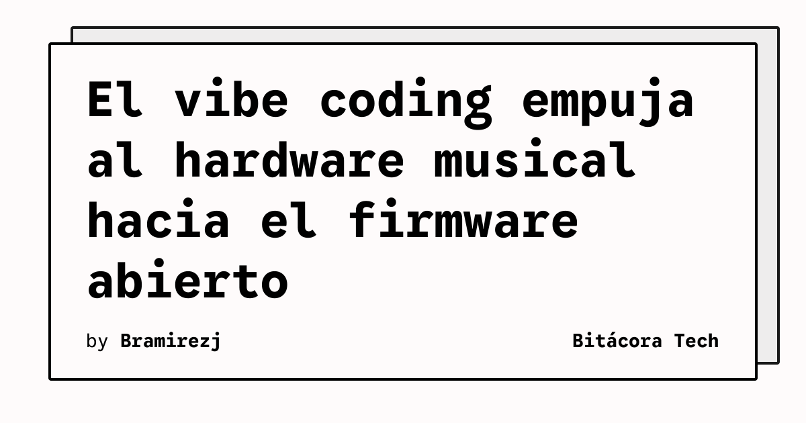

Las herramientas de programación asistida por inteligencia artificial están cambiando la relación entre los usuarios y el hardware musical. The Verge describe cómo agentes de «vibe coding» y herramientas como Reverse Engineer Anything han facilitado que comunidades de aficionados inspeccionen y modifiquen equipos, una práctica que está obligando a varias empresas a reconsiderar su estrategia.

El fenómeno afecta a sintetizadores y otros dispositivos cuyo comportamiento depende de firmware. La frontera entre producto terminado y plataforma experimental se vuelve más difícil de mantener. Los usuarios ya no solo consumen el producto tal como sale de fábrica: también experimentan con sus funciones, crean modificaciones y comparten hallazgos. La comunidad se convierte así en una fuente visible de pruebas. El reporte señala que algunas compañías han empezado a abrir más partes de sus dispositivos, mientras otras todavía no han fijado una postura pública.

## Qué implica

Abrir firmware puede ampliar la vida útil de un equipo y permitir que una comunidad corrija errores o diseñe funciones nuevas. También exige separar con claridad qué componentes son modificables, qué garantías siguen vigentes y cómo se protegen las partes que controlan actualizaciones o seguridad.

Para los fabricantes, la apertura ofrece una forma de colaborar con usuarios avanzados en lugar de competir con ellos. Pero también implica documentar interfaces, aceptar variantes no previstas y definir un proceso para integrar o rechazar contribuciones. En equipos conectados, además, una modificación puede afectar la confianza del dispositivo y la distribución de actualizaciones.

## Hechos confirmados

- Herramientas de programación asistida y comunidades de modding están facilitando modificaciones de equipos musicales.
- Algunas empresas del sector han comenzado a abrir más partes de sus dispositivos.
- The Verge identifica a inMusic, matriz de Akai, Moog y Native Instruments, entre las compañías que han respondido al movimiento.

## Análisis

El cambio más interesante no es que un agente genere código, sino que reduce la distancia entre descubrir una limitación y probar una modificación. Si los fabricantes ofrecen documentación y límites técnicos claros, el código abierto puede convertirse en un canal de innovación y soporte comunitario. Si lo ignoran, las modificaciones seguirán ocurriendo, pero con menos trazabilidad y más riesgos para usuarios y dispositivos.

**Fuente:** [The Verge](https://www.theverge.com/ai-artificial-intelligence/1040081/vibe-coding-open-source-music-firmware).
