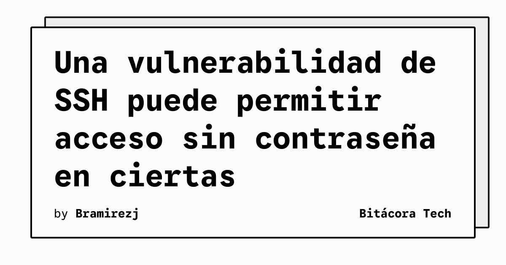

Una vulnerabilidad de hace una década puede permitir que un atacante acceda por SSH sin conocer la contraseña en determinadas configuraciones de Alpine Linux. Ars Technica la identifica con el nombre «sshole» y advierte que otras distribuciones podrían verse afectadas si reproducen la misma combinación técnica.

El problema aparece en la interacción entre OpenSSH, la biblioteca que implementa las conexiones SSH, y musl, una alternativa ligera a libc utilizada por Alpine. La configuración vulnerable también requiere que OpenSSH use musl sin PAM, el sistema de módulos que gestiona la autenticación y los controles de acceso.

## Qué implica

La explotación no depende únicamente de tener un servicio SSH expuesto. El sistema debe cumplir condiciones adicionales: al menos una cuenta debe ser accesible mediante una contraseña cuyo hash use SHA-256 o SHA-512, y la cuenta objetivo debe estar configurada sin contraseña mediante un asterisco en el campo correspondiente de `/etc/shadow`.

Ese ajuste puede aparecer en cuentas que usan autenticación mediante certificados. Cuando se reúnen las condiciones, un atacante con acceso al puerto SSH podría iniciar sesión sin introducir una contraseña. Por eso la revisión debe abarcar tanto la versión de OpenSSH como la configuración de las cuentas, la biblioteca C utilizada y la presencia o ausencia de PAM.

Alpine es una distribución ligera y extendida, por lo que el alcance no se limita a un equipo de laboratorio. La posibilidad de que otros sistemas compartan la combinación vulnerable exige validar cada entorno en lugar de asumir que una distribución diferente queda automáticamente fuera de riesgo.

## Hechos confirmados

- Ars Technica describe una vulnerabilidad de aproximadamente una década en ciertas configuraciones.
- El escenario afecta a OpenSSH cuando funciona con musl y sin PAM.
- La configuración vulnerable requiere una cuenta con un hash SHA-256 o SHA-512 y una cuenta objetivo sin contraseña.
- Un atacante que alcance el puerto SSH podría iniciar sesión sin conocer una contraseña.
- El artículo señala que otras distribuciones podrían estar afectadas si usan la misma configuración.

## Análisis

La respuesta operativa no debería consistir solo en cambiar contraseñas. Los equipos responsables deben inventariar los servicios SSH expuestos, revisar `/etc/shadow`, confirmar si PAM está activo y comprobar las recomendaciones del mantenedor de la distribución antes de decidir una mitigación. También conviene limitar el acceso de red al servicio mientras se valida el alcance.

El caso recuerda que la seguridad de SSH depende de la interacción entre componentes y de sus ajustes locales. Una configuración diseñada para autenticación mediante certificados puede introducir un comportamiento inesperado cuando se combina con bibliotecas y opciones concretas.

**Fuente:** [Ars Technica](https://arstechnica.com/security/2026/11/vulnerability-allows-attackers-to-log-into-some-linux-devices-sans-password/).
