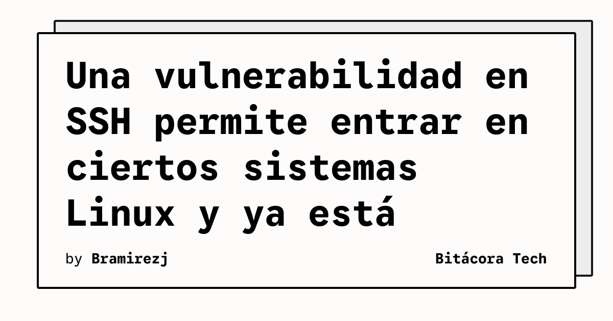

Investigadores informan de la explotación activa de una vulnerabilidad crítica que puede permitir iniciar sesión sin autenticación en cuentas privilegiadas de ciertos sistemas Linux. El problema, denominado «*sshole» y registrado como CVE-2026-123158, aparece por la interacción entre OpenSSH y musl, una biblioteca utilizada como alternativa a libc.

## Qué implica

El riesgo no afecta indiscriminadamente a todos los servidores SSH. Ars Technica explica que deben coincidir varias condiciones: OpenSSH debe ejecutarse junto con musl y sin PAM; además, la configuración debe incluir al menos una cuenta accesible con una contraseña cuyo hash use SHA-256 o SHA-512 y cuentas sin contraseña indicadas mediante un asterisco en `/etc/shadow`.

El ataque se activa cuando el adversario introduce una contraseña de más de 256 caracteres para una cuenta sin contraseña. Al procesarla, la función de hash de musl devuelve un asterisco como error. La interpretación posterior de esa cadena por OpenSSH puede confundirla con un hash válido y abrir el acceso.

## Hechos confirmados

- La vulnerabilidad se identifica como CVE-2026-123158 y afecta a OpenSSH cuando se combina con musl bajo determinadas configuraciones.
- Ars Technica reporta que investigadores observaron explotación activa pocos días después de que el problema se hiciera público.
- GreyNoise observó ataques contra honeypots en el Sudeste Asiático por parte de un grupo que rastrea como GT10.
- Previdian informó de 20 intentos de explotación procedentes de 13 direcciones IP ubicadas en nueve países.
- Alpine Linux es una de las distribuciones especialmente relevantes por su uso de musl.
- El artículo recomienda instalar la actualización de OpenSSH y revisar con atención los sistemas que usan musl.

La explotación requiere varias características específicas, pero los servidores SSH expuestos a Internet pueden ser identificados y probados rápidamente. Por eso, la presencia de una condición adicional en la configuración no elimina la necesidad de revisar los sistemas afectados.

## Análisis

Los administradores deberían inventariar qué servidores usan musl, comprobar la versión de OpenSSH y comparar sus configuraciones de autenticación con las condiciones descritas. La prioridad es aplicar las actualizaciones disponibles y reducir la exposición de SSH mientras se completa la revisión. El caso también muestra por qué una configuración aparentemente poco habitual puede convertirse en un riesgo cuando interactúan componentes que normalmente se auditan por separado.

**Fuente:** [Ars Technica](https://arstechnica.com/security/2026/11/vulnerability-that-lets-hackers-ssh-into-linux-devices-is-under-active-exploitation/).
